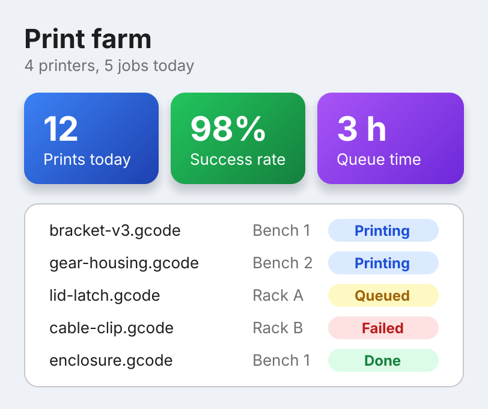
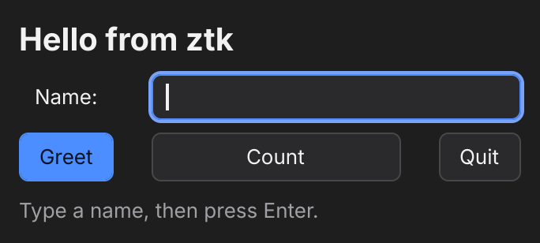

# ztk

A Tk replacement in Zig, on the [ztcl](https://github.com/beetlebugorg/ztcl) interpreter, with a GPU renderer and stylesheets in a subset of CSS.

> [!WARNING]
> **Experimental.** This repository has the code of Stage 1: a demo-sized toolkit. ztk is not a drop-in Tk. The plan, the commands, and the behavior can change at any time.

> [!IMPORTANT]
> **AI disclaimer.** The docs and the code are written largely with AI coding agents, under human direction. Review the work before you depend on it. ztk comes with no warranty. See [LICENSE](LICENSE).

**Docs:** https://beetlebug.org/ztk/




ztk drew these windows from [`examples/dashboard.tcl`](examples/dashboard.tcl) and [`examples/gallery.tcl`](examples/gallery.tcl) and their stylesheets, with the CPU renderer on the headless backend. The [docs site](https://beetlebug.org/ztk/#screenshots) has more examples, in light and dark.

## Status

Stage 1 is built. Four independent reviews said "do not merge" or "not yet". The fixes for the fourth review are in this code, and no review has checked them. Stage 1 has `frame`, `label`, `button`, `entry`, `grid`, `bind`, `event generate`, `focus`, `wm`, and `winfo` for `.`, a CSS subset with a modern theme, a font engine with no library, a CPU renderer, a Vulkan renderer (offscreen, checked against the CPU renderer on two GPUs), a render thread, and three backends: headless, Wayland (CPU renderer into shared memory), and direct (framebuffer and evdev). `examples/demo.tcl` runs in ztk and in `wish` 8.6.16. [The report](docs/stage1-report.md) has the test counts.

What does not work: the Vulkan swapchain on a window and on a display, a window on the live desktop (not tried), the direct backend on a real device (not tried, and `--direct` needs the flag `--direct-unsafe-test-device`, because ztk does not own the VT), the other widgets and commands of Tk, and two rules of the `grid` solver (the oracle shows 11 differences in 600 random layouts). The tests run on Linux only. The headless program compiles for macOS and Windows, and no run on these systems has checked it. [The report](docs/stage1-report.md) has the numbers, and [the limits](docs/stage1-limits.md) list what each widget lacks.

- [The plan](docs/plan.md) has the goal, the architecture, the decisions, the performance targets, the verification strategy, and the stages.
- [The Stage 1 tasks](docs/tasks/README.md) are the 22 small tasks of the first demo.
- [The widget stage](docs/stage2-tasks/README.md) adds every widget of Tk 8.6. Done so far: `pack`, `place`, animation (`transition`, `@keyframes`, `ztk::animate`), `checkbutton`, `radiobutton`, `toplevel`, `labelframe`, `message`, `grab`, and `ztk::tooltip`. [The limits](docs/stage2-limits.md) list what these lack.
- [The review checklist](docs/review.md) is what a reviewer checks for each task.
- [The size of Tk](docs/tk-size.md) has the measured size of the job.

Run it: `zig build`, then `zig-out/bin/ztk --headless examples/demo.tcl`, or `zig-out/bin/ztk examples/demo.tcl` in a Wayland session. On Linux the default build needs `glslc`, the Wayland client library, `wayland-protocols`, and `libxkbcommon`. On macOS and Windows the default build has the headless backend only.

## Relationship to ztcl

[ztcl](https://github.com/beetlebugorg/ztcl) is a separate project: an experimental Tcl interpreter in Zig. ztk adds the Tk commands to ztcl and uses it as a Zig package. ztk does not change ztcl.

## The goal

A script that runs in `wish` 8.6 runs in ztk with no change. The test files of Tk 8.6.16 measure that.

- The default look is a modern theme from a stylesheet, with one more stylesheet for each platform. A classic theme has the sizes and the colors of Tk.
- A GPU draws each frame. The target is 60 frames in each second.
- ztk runs on Linux, macOS, Windows, and the web. On a Linux device with no display server, it draws directly on the display.
- ztk needs no third-party library on any platform. It uses the interfaces of the platform, ztcl, and the Zig standard library.

## The size of the job

Measured on Tk 8.6.16 (2026-11-23):

| What | Count |
|---|---|
| Manual pages for script commands | 87 |
| Widget classes, classic and `ttk` | 18 and 18 |
| Options of these classes | 542 and 226 |
| Test files | 109 |
| Tests that a real `wish` counted | 10 221 |
| Source lines of Tk | 322 187 |

The plan estimates two and a quarter to three and a half years of work for one engineer, in nine stages after the plan. Stage 1 is the first demo: a Tcl script with `grid`, labels, buttons, and an entry in a styled window on Linux.

## The demo of Stage 1

This script is the target. It also runs in `wish` 8.6.

```tcl
label .title -text "Hello from ztk"
entry .name -textvariable name -width 24
button .greet -text "Greet" -command {set msg "Hello, $name!"}
label .msg -textvariable msg
grid .title -sticky w -padx 12 -pady 6
grid .name .greet -sticky ew -padx 12 -pady 4
grid .msg - -sticky w -padx 12 -pady 6
bind .name <Return> {.greet invoke}
```

```css
Button { border-radius: 6px; padding: 6px 12px; transition: all 120ms }
Button:hover { background: var(--accent); color: var(--accent-fg) }
```

[`examples/demo.tcl`](examples/demo.tcl) is the full demo, with a stylesheet. ztk draws it in the dark scheme with `--dark`:



## Documentation

- [The plan](docs/plan.md)
- [The Stage 1 tasks](docs/tasks/README.md)
- [The review checklist](docs/review.md)
- [The size of Tk](docs/tk-size.md)
- [References](docs/references/README.md)
- [Lessons from Printdeck](docs/references/printdeck.md)
- [Writing rules](WRITING.md) and [agent instructions](AGENTS.md)

## License

ztk is licensed under [BSD-2-Clause](LICENSE). ztk has no code of Tk. It credits Tk and its other sources in [References](docs/references/README.md).
