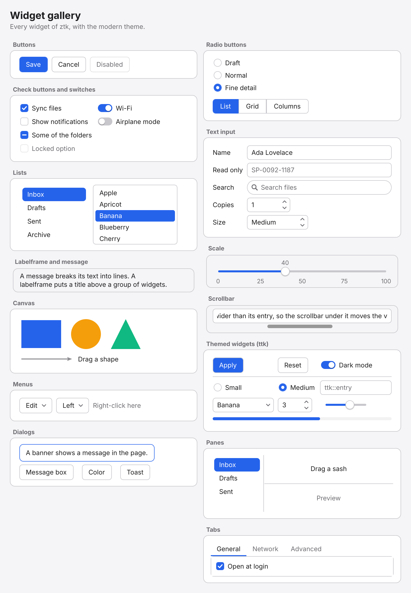

# ztk

Tk, rebuilt in Zig. ztk runs Tk scripts on the [ztcl](https://github.com/beetlebugorg/ztcl) interpreter, with a GPU renderer, a modern look from CSS, smooth animation, and a WebAssembly build for the browser.

**Docs and live demos:** https://beetlebug.org/ztk/



- **Tk scripts.** `frame`, `label`, `button`, `entry`, `spinbox`, `scale`, `scrollbar`, `canvas`, the simple `ttk` widgets, `pack`, `grid`, `place`, and `bind`. Each example also runs in `wish` 8.6.
- **A modern look.** A stylesheet in a subset of CSS styles each widget, with a dark scheme, transitions, and a classic theme with the look of Tk.
- **Fluid.** A frame with 1,000 widgets uses 0.85 ms of CPU time at the 99th percentile, and a render thread draws animations while the script is busy.
- **On the web.** The same scripts run in the browser with WebGPU, WebGL 2, or a 2D canvas.
- **No third-party library.** ztk uses the platform, ztcl, and the Zig standard library.

## Install

```sh
npm install @beetlebug/ztk     # for the web
```

[Install](docs/install.md) has the release binaries and the build from source.

## Example

```tcl
ttk::label .title -text "Hello from ztk"
ttk::entry .name -textvariable name
ttk::button .greet -text "Greet" -style Accent.TButton -command {set msg "Hello, $name!"}
ttk::label .msg -textvariable msg
pack .title .name .greet .msg -padx 12 -pady 4 -anchor w
ttk::style configure Accent.TButton -foreground white -background #2563eb
```

```sh
ztk hello.tcl
```

## Documentation

- [Quick start](docs/quickstart.md) and [the widgets](docs/widgets/README.md)
- [Styling and themes](docs/styling.md) and [animation](docs/animation.md)
- [On the web](docs/web.md) and [embed in Zig](docs/embedding.md)
- [Performance](docs/performance.md) and [differences from Tk](docs/differences.md)
- For contributors: [docs/dev/](docs/dev/README.md) has the plan, the task lists, and the reports.

## Status

ztk is experimental, and it is not yet a drop-in Tk. Many widgets of Tk are still missing, among them `listbox`, `text`, `menu`, `ttk::notebook`, and `ttk::treeview`. On Linux it draws to a Wayland window with the CPU renderer. macOS and Windows have only the headless backend so far. The code and the docs were written largely with AI coding agents, under human direction. Review the code before you depend on it. The [plan](docs/dev/plan.md#11-stages) has the roadmap, and the [issues](https://github.com/beetlebugorg/ztk/issues) take bug reports and requests.

## License

BSD-2-Clause. See [LICENSE](LICENSE). ztk has no code of Tk. [References](docs/references/README.md) credits Tk and the other sources.
