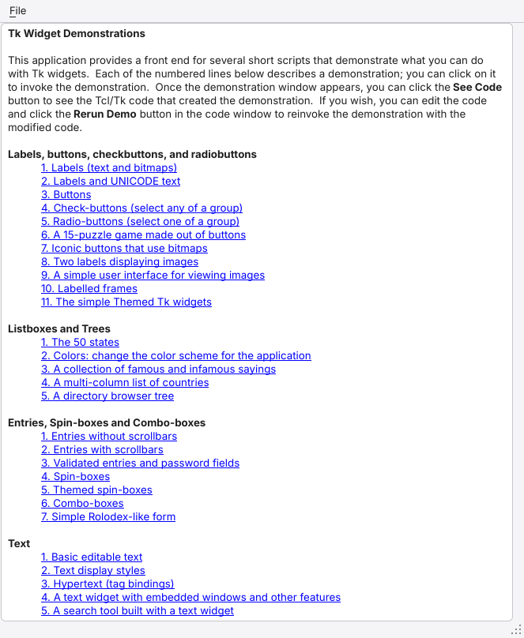
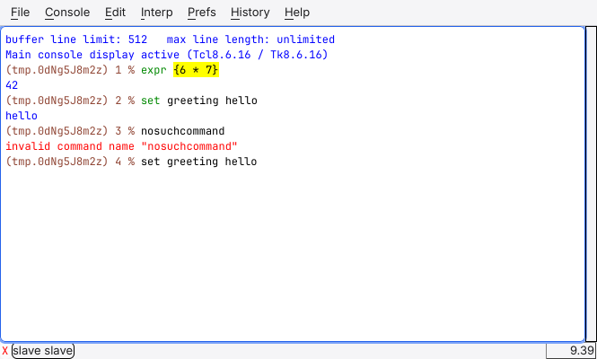
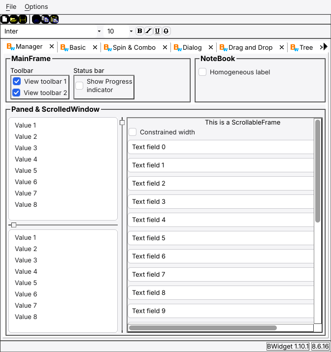
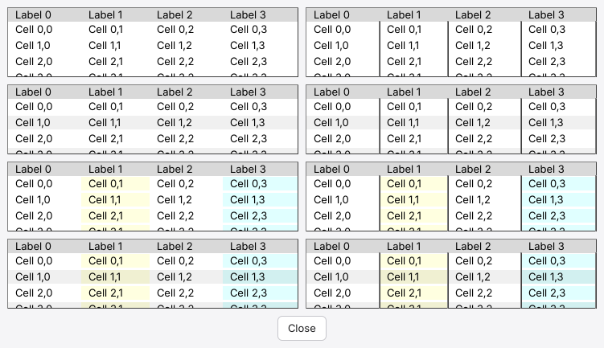
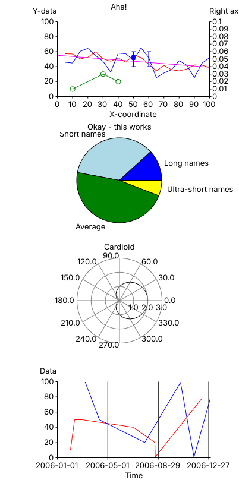
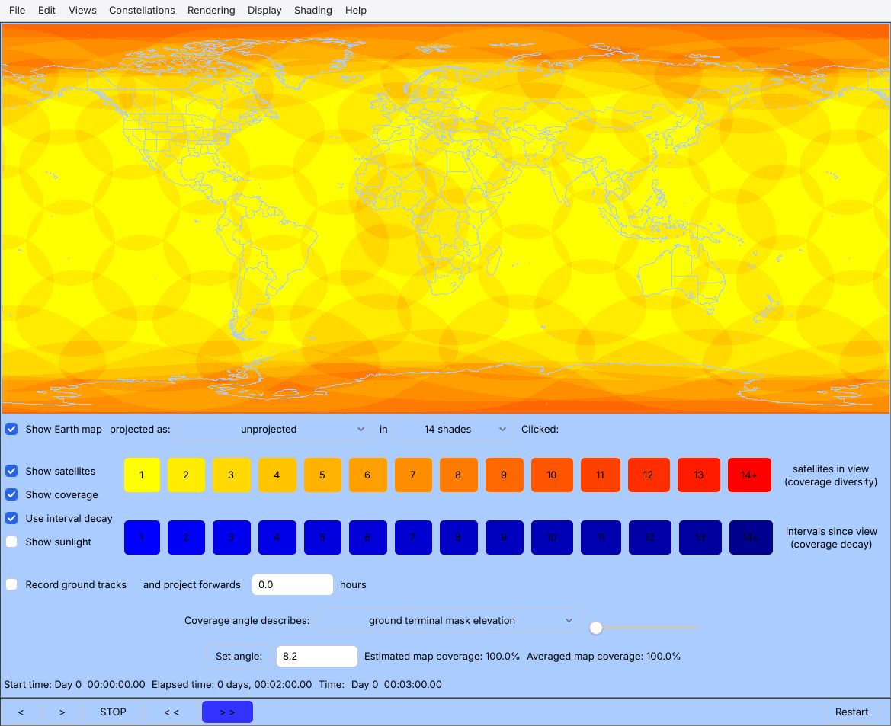
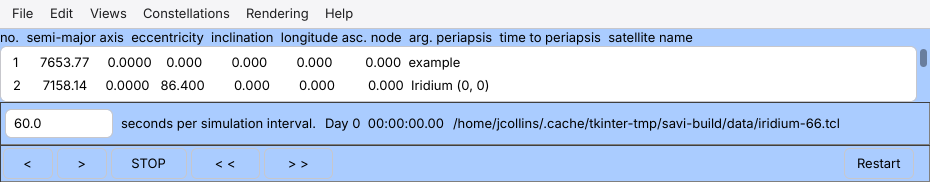

# Runs on ztk

These well-known Tcl/Tk apps run on ztk with no change to their code. Each app has a pinned release and a script that uses it as a person does: clicks, keys, and typed text through `ztk::inject`. The full CI run runs each script every 6 hours, so a regression shows. Each image is a screenshot of the app on ztk, made by its script on the headless backend.

The table with each check and each gap is in [the app table](https://github.com/beetlebugorg/ztk/blob/main/docs/dev/apps.md) of the repository.

To try an app, build ztk, download the pinned releases, and run the scripts:

```sh
tools/fetch-apps.sh
tests/famous-apps.sh shots
```

An app runs with the flag `--windowingsystem x11`, because these apps test for `x11`, `win32`, or `aqua`. For example, tkcon:

```sh
ztk --windowingsystem x11 --allow package,clock,event,env,interp \
    .apps-src/tkcon/tkcon-2.5/tkcon.tcl
```

## Tk widget demo



Version 8.6.16, `library/demos/widget`. Status: **works with gaps**. A click on each demo line opens its demo. Gaps: [text peers (#249)](https://github.com/beetlebugorg/ztk/issues/249), [Tk in a child interpreter (#250)](https://github.com/beetlebugorg/ztk/issues/250), [canvas bitmaps from a file (#251)](https://github.com/beetlebugorg/ztk/issues/251), [hscale and vscale (#252)](https://github.com/beetlebugorg/ztk/issues/252).

## tkcon



Version 2.5. Status: **works**. The script types commands into the console, gets their results and errors, and recalls a command with Up.

## BWidget demo



Version 1.10.1, `demo/demo.tcl`. Status: **works**. A click on each notebook tab shows its page, and the script types into an entry and clicks a button.

## Tablelist



Version 7.12, six demos. Status: **works**. A click selects a row, a click on a column label sorts, and a double click opens a folder.

## tklib and Plotchart



Version 0.9. Status: **works**. Nineteen Plotchart examples draw their charts, and a tooltip, a ctext widget, and a datefield take a hover and typed text.

## gitk

Version: gitk of git 2.56.0. Status: **works**. In a test repository the list shows the commits, a click on a commit shows its diff, and Up selects the commit above. gitk has the GPL: ztk only runs it, and no code of gitk is in ztk. The page shows no screenshot of it.

## SaVi



Version 1.6.0, satellite constellation visualization by Lloyd Wood and the Geometry Center (https://savi.sourceforge.io/). Status: **works**. SaVi is a C program with Tcl and Tk scripts. It builds with no change against [libztk](python-tkinter.md) and its `tk.h`, and the same program file also runs on the libraries of Tcl and Tk. The script loads Iridium, opens the coverage map, which the C code fills through the photo API, and runs the simulation. The 3D view needs Geomview and is not tried. Run it with `tests/apps/savi/run.sh` after `zig build libztk`. SaVi calls `Tcl_GetCommandInfo`, which libztcl has from ztcl#502 on; the images come from a build of libztk on that branch.



## In progress

- TkDiff 5.7 starts, but its text panes do not show yet ([#253](https://github.com/beetlebugorg/ztk/issues/253)).
- git gui is not tried yet ([#254](https://github.com/beetlebugorg/ztk/issues/254)).
