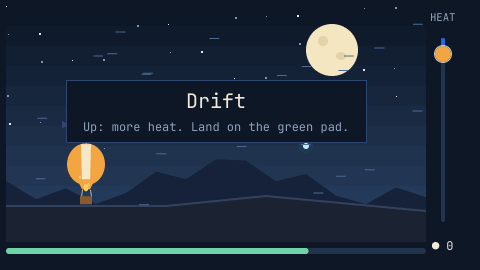

# Tin Moon: the design

Tin Moon is a balloon flight in [one Tcl script](https://github.com/beetlebugorg/ztk/blob/main/docs/toys/tinmoon.tcl). You steer only with height. [Play it on the Toys page](../toys.md) or on the home page.

## The widgets

The `ttk::scale` on the right is the burner, on `-variable heat`. Drag it, or hold Up and Down: the keys move the scale, so you see the heat that you set. The `ttk::progressbar` under the sky is the fuel, on `-variable fuel`. The burner uses fuel at the rate of the heat, and with no fuel the burner is off.

## The idea

A balloon cannot steer left or right. Each layer of the sky has its own wind, and the streaks and the arrows of a layer show its way and its speed. To go east, climb or sink into a wind to the east. The heat changes the air in the envelope slowly, so the balloon answers late: you plan a climb before you need it. Land on the green pad slowly. A fast touch, a large swing of the basket, or a spire is a crash.

## The levels

| Level | The winds | The new idea |
|---|---|---|
| Drift | One wind to the east | Rise, drift, and sink onto the pad. |
| Two Winds | East above, west below | Climb to go east fast, then sink. |
| Back Home | West above, calm, east below | The pad is behind you. |
| Spires | Three layers | Rock spires under the low wind. |
| Long Night | Three layers, little fuel | A long route with each idea. |

The score of a landing is the fuel left times 10, and 250 for each moon mote. The best score of each level stays in the browser.

## The feel

- The wind of a layer moves the balloon with a lag, so a change of layer is a slow turn.
- The basket swings on its ropes when the balloon speeds up, and a large swing at a landing is a crash.
- The camera leads the balloon by its speed and eases to it. The sky stays, the far hills move at half the speed, and the ground moves at full speed.
- A gust plays when you enter a new layer, and the burner roars while the heat is high.

## The art and the sound

A blue night with a large moon, an amber balloon with a cream stripe, and a mint pad with lights that blink. The music is a slow line in D dorian. Both are made at run time.

## The checks

A pilot script sets the burner in each frame with the physics of the game, and two forms of it landed on the pad of each level:

- A search holds the height of the best wind and starts to sink at a point; it tries a point every 40 pixels. It lands Drift (sink from x 560 or 600, 87 fuel left), Two Winds (from x 800 or 840, 82 fuel left), and Back Home (from x 200, 71 fuel left).
- A pilot that sinks when the time to the pad is less than the time to the ground lands Spires (32 fuel left) and Long Night (55 fuel left).

The windows of these points are narrow for a script with fixed rules, and a player corrects in each frame. The landing limits are a sink speed of 1.5 pixels a frame and a swing of the basket of 12 pixels. The clip above is a run of the pilot in the live frame loop that comes in too fast.
