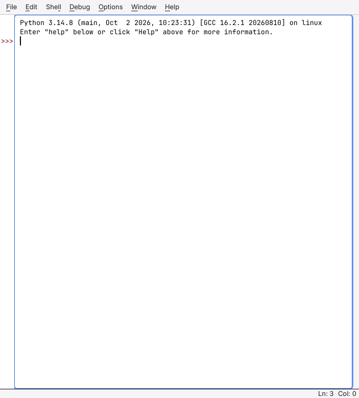
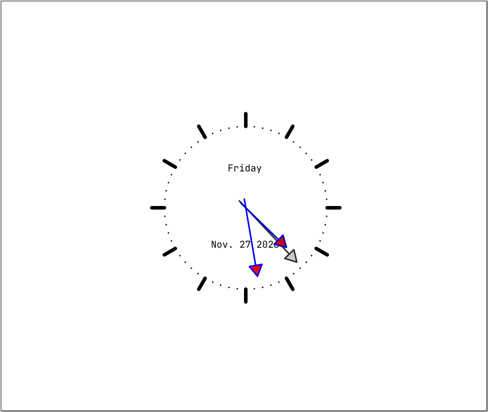
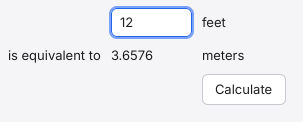

# Python tkinter on ztk

Python's `tkinter` is a small C module, `_tkinter`, over the libraries libtcl8.6 and libtk8.6. libztk is one shared library with ztcl and ztk that has the C API of Tcl 8.6 and the part of the C API of Tk 8.6 that `_tkinter` and common extensions call. A tkinter program runs on ztk with no change to the program and no change to Python.

> [!WARNING]
> libztk is new. It runs on Linux only. The table below gives the programs that were checked and the gaps that are known.

## Build and run

```sh
zig build libztk
LD_LIBRARY_PATH=zig-out/lib python3 your_app.py
```

The step writes two files. `zig-out/lib/libtcl8.6.so` has ztcl and ztk, the Tcl functions, and the Tk functions with the prefix `ztk_`. `zig-out/lib/libtk8.6.so` is small: it links libtcl8.6.so and has the names of the Tk functions, each a jump to its `ztk_` function. So `_tkinter` gets one copy of ztcl, and a C program built against libztk records both libraries, as with Tcl and Tk, and also runs on the libraries of Tcl and Tk.

The step also installs `zig-out/include/tk.h`, a header with the part of the Tk API that libztk has, written from the manual pages of Tk. Use it with the Tcl headers of the kit of libztcl (`zig build libztcl` in ztcl) to build a C program such as SaVi.

The backend comes from the environment:

| Variable | Backend |
|---|---|
| `ZTK_HEADLESS=1` | The headless backend, with the clock of the process. No window opens. |
| `WAYLAND_DISPLAY` | Wayland. |
| `DISPLAY`, with no `WAYLAND_DISPLAY` | X11. |

`ZTK_NO_ANIMATION=1` turns the transitions off. `tk windowingsystem` gives `x11` on Linux, so a program that tests for `x11`, `win32`, or `aqua` runs its X11 code.

## What libztk has

- The Tcl API of libztcl (ztcl `docs/dev/libztcl.md`), with an event loop over the loop of ztk: `Tcl_DoOneEvent`, `Tcl_CreateTimerHandler`, `Tcl_CreateFileHandler`, and `Tcl_ThreadQueueEvent` for the calls of other Python threads.
- `Tk_Init`, `Tk_MainWindow`, `Tk_GetNumMainWindows`, `Tk_MainLoop`, and `Tk_CreateWindow`.
- The photo API of `FindPhoto.3`: `Tk_FindPhoto`, `Tk_PhotoPutBlock`, `Tk_PhotoPutZoomedBlock` (with the zoom 1), `Tk_PhotoGetImage`, `Tk_PhotoBlank`, `Tk_PhotoGetSize`, `Tk_PhotoSetSize`, and `Tk_PhotoExpand`. Pillow's `ImageTk` and matplotlib's TkAgg backend use them.
- The bignum functions of the tommath table that `_tkinter` imports, for Python integers past 64 bits.

The Tk stubs table (`Tk_InitStubs`) is not there yet, so a Tk extension that loads with stubs does not load.

## Results

Checked on 2026-11-27 on x86-64 Arch Linux with Python 3.14.8 (the `_tkinter` of the system, against Tcl/Tk 8.6.16), with the headless backend, unless the row says otherwise. The machine had a load of about 20 on 8 cores from other work, so the times are rough.

### The tkinter tests of CPython

The tests of `Lib/test/test_tkinter` and `Lib/test/test_ttk` of CPython 3.14.8, run one file at a time with `python3 -m test -u gui -v` (the system Python has no test package, so the files come from the source release):

| Test file | Tests | Pass on ztk |
|---|---:|---:|
| test_tkinter.test_colorchooser | 3 | 3 |
| test_tkinter.test_dnd | 11 | 11 |
| test_tkinter.test_filedialog | 7 | 7 |
| test_tkinter.test_font | 18 | 15 |
| test_tkinter.test_geometry_managers | 59 | 42 |
| test_tkinter.test_images | 40 | 16 |
| test_tkinter.test_loadtk | 2 | 0 |
| test_tkinter.test_messagebox | 1 | 1 |
| test_tkinter.test_misc | 112 | 87 |
| test_tkinter.test_scrolledtext | 4 | 4 |
| test_tkinter.test_simpledialog | 23 | 17 |
| test_tkinter.test_text | 31 | 29 |
| test_tkinter.test_tkinter_pipe | 2 | 2 |
| test_tkinter.test_variables | 25 | 22 |
| test_tkinter.test_widgets | 676 | 421 |
| test_ttk.test_extensions | 30 | 20 |
| test_ttk.test_style | 20 | 6 |
| test_ttk.test_widgets | 348 | 204 |
| Total | 1,412 | 907 |

A test with subtests counts once. The column Pass counts the lines `ok` of the verbose output, from a ReleaseFast build before the last canvas change of this page (the negative `xview moveto` of a canvas). The first run of the day, before the fixes of this work, passed 834.

On the Tk 8.6.16 of the system in a private Xvfb, all 1,412 tests pass and 35 are skipped. Most failures on ztk are differences of ztk itself, the same with or without Python: an option value that `wish` rejects and ztk accepts, the text of an error, and a value that Tk gives as a list or a number and ztk gives as text.

### Programs

Each program ran unchanged with `ZTK_HEADLESS=1`. `ZTK_SCRIPT` sourced a script that wrote a snapshot of each window after some seconds and then called `exit`.

| Program | Result |
|---|---|
| IDLE (`python3 -m idlelib`) | The shell window opens with its menus, the banner, and the prompt. |
| turtledemo viewer (`python3 -m turtledemo`) | The window opens with its menus, the code pane, and the canvas. |
| turtle demos (`python3 -m turtledemo.NAME`), 19 of them | Each starts and gives a snapshot with no Python error. clock, bytedesign, rosette, and tree finish in the time of the run. The drawing is slower than on Tk. |
| The first example of the tkinter docs, and the feet to meters example of the Tk tutorial | Both work. |
| Pillow `ImageTk.PhotoImage` | The image shows. `ImageTk.getimage` gives the pixels back with the alpha of Tk. |
| A widget-heavy window (`tools/libztk/widgets.py`) | The notebook, 200 widgets, a treeview of 500 rows, and a text show. |
| matplotlib with TkAgg | Not checked: matplotlib asks for a running X or Wayland display, and these runs were headless. |
| SaVi 1.6.0 (a C program of Tk) | Works. See [Runs on ztk](apps.md). |








### Speed and memory

The time from `import tkinter` to the first `update` of a `Tk()`, and the time to make a window with a notebook of 200 widgets in a form, a treeview of 500 rows, and a text of 200 lines (`widgets.py`), each the median of 5 runs of `tools/libztk/bench.sh` in a private Xvfb (libztk on the X11 backend). The memory is the largest resident set of the process. libztk is a ReleaseFast build.

| | Tk 8.6.16 | libztk |
|---|---:|---:|
| Startup | 0.083 s | 0.068 s |
| Memory after startup | 20,156 KB | 24,364 KB |
| Widget-heavy window | 0.128 s | 0.104 s |
| Memory of that window | 28,980 KB | 42,284 KB |

## Known gaps

- Linux only. A build for arm64 Linux stops at the variadic Tcl slots of libztcl (Zig 0.17 disables `VaList` there), and libztcl has no Windows build. macOS needs the AppKit backend in `Tk_Init`.
- The X11 backend has one window, so a program with a second toplevel needs Wayland or the headless backend.
- The Tk stubs table (`Tk_InitStubs`) is missing, so a Tk extension built with stubs does not load.
- `exit` from a script during a busy loop of `update` in Python does not end the process.
- `Tcl_GetCommandInfo` comes with ztcl#502; SaVi needs it.
- The `tk` test failures above: options that ztk accepts and Tk rejects, error texts, list and number results of some commands, `send`, and the PRIMARY selection.
