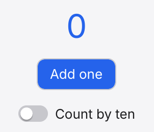

# Quick start

This page builds a small window with a script and a stylesheet. [Install](install.md) ztk first, or paste the script into the [playground](https://beetlebug.org/ztk/play/index.html).

## The script

Save this file as `counter.tcl`:

```tcl
ztk::style load counter.css
wm title . "Counter"
set count 0
set fast 0
ttk::label .value -textvariable count
ttk::button .add -text "Add one" -style Accent.TButton -command {incr count [expr {$fast ? 10 : 1}]}
ttk::checkbutton .fast -text "Count by ten" -style Switch.TCheckbutton -variable fast
pack .value .add .fast -padx 16 -pady 6
bind . <Key-space> {.add invoke}
```

The commands are the commands of Tk. `ttk::button`, `pack`, `-textvariable`, and `bind` work as in `wish`.

## The stylesheet

Save this file as `counter.css` in the same folder:

```css
#value { font-size: 32px; color: var(--accent); }
TButton.Accent { background: var(--accent); color: var(--accent-fg); border-radius: 8px; }
TButton.Accent:hover { background: var(--accent-hover); }
```

A type selector is the class of a widget (`TButton`), `#value` is the last part of the path `.value`, and `.Accent` is the style `Accent.TButton`. The variables come from the modern theme, so the colors follow the light and the dark scheme.

## Run it

```sh
ztk counter.tcl                       # a window, in a Wayland session
ztk --headless --scale 2 --exit-after-frames 1 --screenshot counter.png counter.tcl
```



## Next steps

- [All widgets](widgets/README.md), each with a live example.
- [Styling and themes](styling.md): CSS, the classic theme, and `ttk::style`.
- [Animation](animation.md): transitions and `ztk::animate`.
- [On the web](web.md): run the same script in a page.
