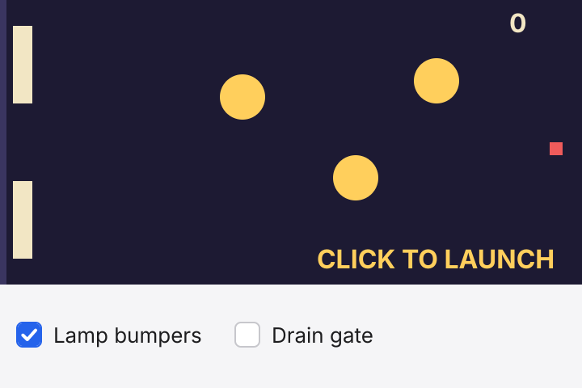
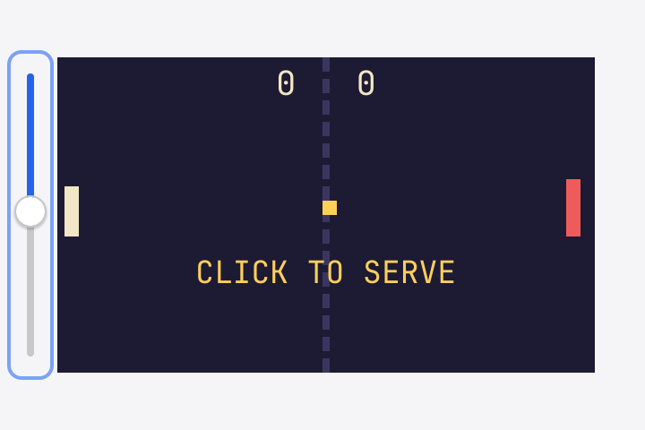
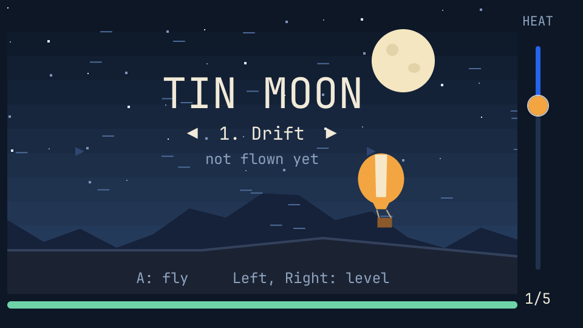
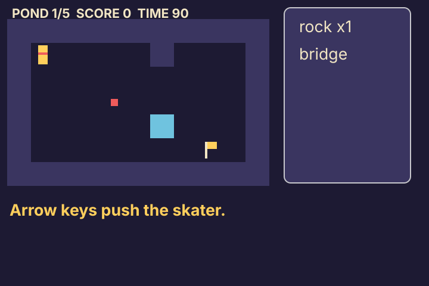
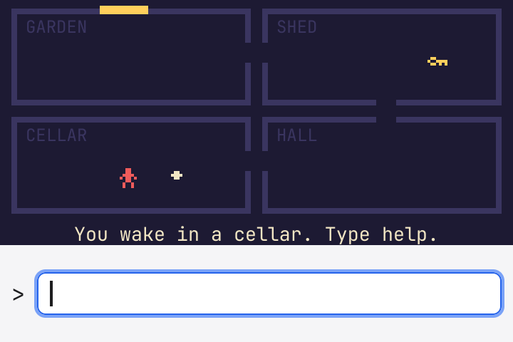
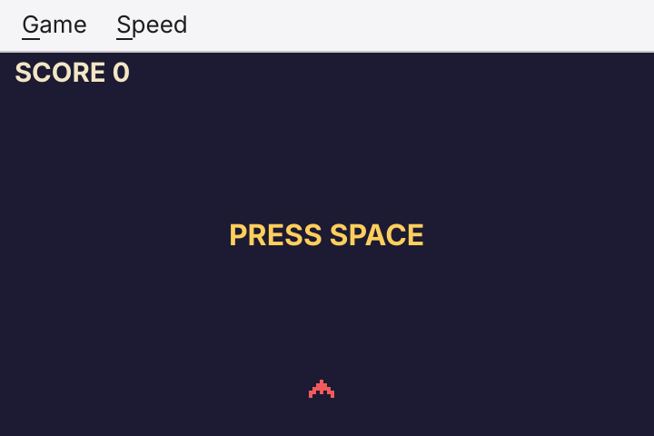
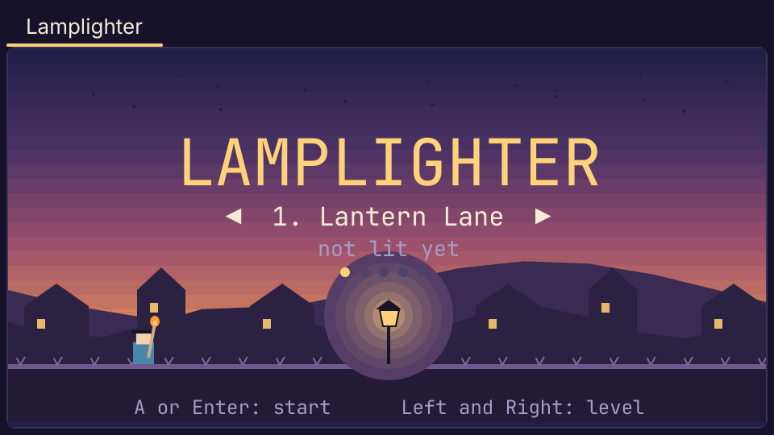
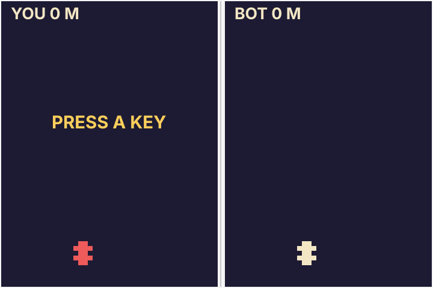

# Toys

Each toy is a small arcade game in ztk, and the widget of its page drives it. A toy runs in the page as WebAssembly, in a handheld with a pad and two buttons. Its code is next to it, so you can edit it as it runs. With "Play on the page" on, a ball or a ship can leave the screen and bounce off the headings and the code of the page. Escape or a scroll brings it back. A toy starts only on a key or a click, its sound is off until you turn it on, and it stops when it is off the screen.

| Toy | Widget | What the widget does |
|---|---|---|
|  [Moth Lamp](widgets/toggles.md#play-moth-lamp) | `checkbutton` | Two check buttons are the flippers of a pinball table, and three show its lamps. |
|  [Backspin](widgets/range.md#play-backspin) | `scale` | The scale is your paddle in a match to 7 points. |
|  [Tin Moon](widgets/ttk.md#play-tin-moon) | `ttk::scale`, `ttk::progressbar` | The scale is the throttle of the lander, and the progress bar is its fuel gauge. |
|  [Skate Pond](widgets/listbox.md#play-skate-pond) | `listbox` | The listbox is the bag of a puzzle on ice: select items and use them to cross 5 ponds. |
|  [Cellar Door](widgets/entry.md#play-cellar-door) | `entry` | The entry is the prompt of a text adventure. |
|  [Puffshot](widgets/menus.md#play-puffshot) | `menu` | The menu bar and a context menu run the game. |
|  [Lamplighter](widgets/panes.md#play-lamplighter) | `ttk::notebook` | Each tab is a scene of one world. |
|  [Twin Lanes](widgets/panes.md#play-twin-lanes) | `panedwindow` | The sash sets the width of each road of a race. |
