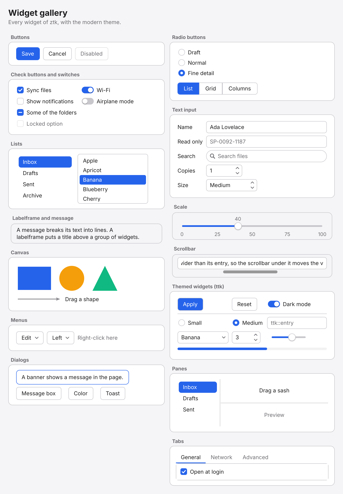

# Widgets

ztk has the widgets below today. Each one has the commands and the options of Tk 8.6, and the modern theme gives it its look. Each page has a runnable example and a link to a live demo in the playground. [Differences from Tk](../differences.md) lists what each widget lacks.

| Page | Widgets and commands |
|---|---|
| [Frames, labels, and buttons](basic.md) | `frame`, `label`, `button`, `labelframe`, `message`, `toplevel`, `grab`, `ztk::tooltip` |
| [Check and radio buttons](toggles.md) | `checkbutton`, `radiobutton`, the switch and the segmented control |
| [Entry and spinbox](entry.md) | `entry`, `spinbox`, placeholders, the search field, validation, undo, `clipboard` |
| [Scale and scrollbar](range.md) | `scale`, `scrollbar`, the mouse wheel |
| [Listbox](listbox.md) | `listbox`, the sidebar style |
| [Canvas](canvas.md) | `canvas` with all item types, `image create photo` |
| [Menus](menus.md) | `menu`, `menubutton`, `ttk::menubutton`, `tk_popup`, the menu bar |
| [Terminal](terminal.md) | `ztk::terminal`, a terminal emulator with scrollback and a pseudo-terminal |
| [Themed widgets (ttk)](ttk.md) | `ttk::button`, `ttk::checkbutton`, `ttk::radiobutton`, `ttk::label`, `ttk::frame`, `ttk::labelframe`, `ttk::entry`, `ttk::separator`, `ttk::sizegrip` |
| [pack, grid, and place](geometry.md) | The three geometry managers |

`bind`, `bindtags`, `event generate`, `focus`, `wm`, `winfo`, and `tk` work as in Tk. [Styling and themes](../styling.md) and [Animation](../animation.md) cover the look and the motion.

Coming next: `text`, `panedwindow`, the dialogs, and the other `ttk` widgets (`combobox`, `spinbox`, `scale`, `scrollbar`, `progressbar`, `notebook`, and `treeview`).

Open the [gallery in the playground](https://beetlebug.org/ztk/play/index.html?example=gallery) to try each widget.
