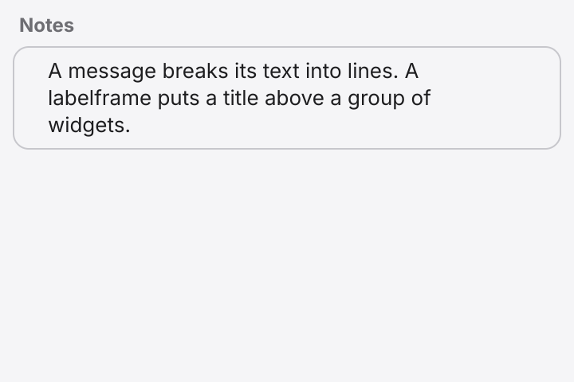
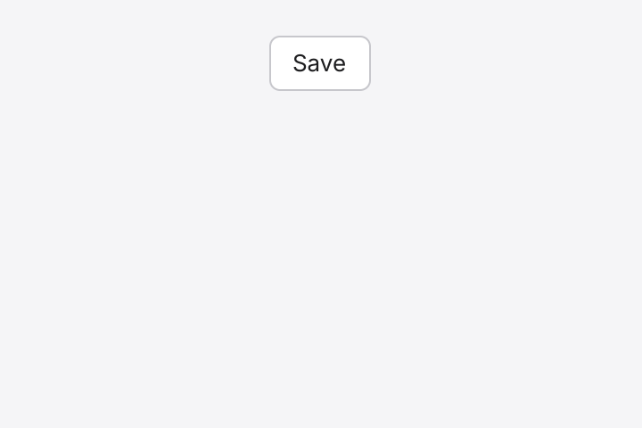

# Frames, labels, and buttons

**Live:** the Buttons card and the Labelframe card of the [gallery](https://beetlebug.org/ztk/play/index.html?example=gallery), and the [sign-in form](https://beetlebug.org/ztk/play/index.html?example=signin).

## frame, label, and button


<!-- widget: button; shot: update -->
```tcl
frame .card -padx 16 -pady 12
label .card.title -text "Print farm"
button .card.go -text "Start" -command {puts started}
button .card.off -text "Stop" -state disabled
pack .card -fill both -expand 1
pack .card.title -anchor w
pack .card.go .card.off -side left -padx 4 -pady 8
```

### Play: Egg Drop

Egg Drop is a race to catch eggs for 60 seconds. Four hens lay eggs, and the four buttons are the baskets: press a button when an egg is in the band above it. The arrow keys press the buttons, and the button shows its active state. Catches in a row raise the points up to 5 times, and a gold egg is 50 points. Three broken eggs end the game.

<!-- widget: toy-eggdrop; shot: update -->
```tcl
# Egg Drop: four hens lay eggs, and the four buttons are the baskets.
# Press a button when an egg is in the band above it. Three broken eggs
# end the game. Last 60 seconds to fill the coop.
set ink {#1d1a33 #f2e6c4 #ef5b5b #ffcf5c #3a3560 #6fc3df}
. configure -background [lindex $ink 0]
canvas .c -width 340 -height 168 -bg [lindex $ink 0] -highlightthickness 0
frame .pads -background [lindex $ink 0]
foreach i {0 1 2 3} key {← ↓ ↑ →} {
    button .pads.p$i -text $key -width 4 -font {TkDefaultFont 14 bold} -command [list press $i] \
        -background [lindex $ink 4] -foreground [lindex $ink 1] \
        -activebackground [lindex $ink 3] -activeforeground [lindex $ink 0]
    pack .pads.p$i -side left -padx 3
}
pack .c -padx 10 -pady {6 0}
pack .pads -pady 4
array set toy {spill 0 out {} back {} sfx {}}
proc lanex {i} { expr {42 + $i * 85} }
# A hen of pixel squares at the top of lane i, with a red comb.
proc hen {i} {
    global ink
    set x0 [expr {[lanex $i] - 12}]
    foreach row {"...R." "..###" "####." ".###." "..#.."} y {0 1 2 3 4} {
        for {set c 0} {$c < 5} {incr c} {
            set ch [string index $row $c]
            if {$ch eq "."} continue
            set fill [lindex $ink [expr {$ch eq "R" ? 2 : 1}]]
            .c create rectangle [expr {$x0 + $c * 5}] [expr {18 + $y * 5}] \
                [expr {$x0 + $c * 5 + 5}] [expr {23 + $y * 5}] -fill $fill -outline {}
        }
    }
}
proc paint {} {
    global g ink
    .c delete all
    .c create rectangle 0 128 340 160 -fill [lindex $ink 4] -outline {}
    foreach i {0 1 2 3} { hen $i }
    foreach e $g(eggs) {
        lassign $e lane y gold
        set x [lanex $lane]
        .c create oval [expr {$x - 6}] [expr {$y - 8}] [expr {$x + 6}] [expr {$y + 8}] \
            -fill [lindex $ink [expr {$gold ? 3 : 1}]] -outline {}
    }
    foreach s $g(splats) {
        set x [lanex [lindex $s 0]]
        .c create rectangle [expr {$x - 12}] 162 [expr {$x + 12}] 166 -fill [lindex $ink 3] -outline {}
    }
    set hearts [string repeat "♥ " $g(lives)]
    .c create text 4 6 -anchor w -fill [lindex $ink 3] -font {TkFixedFont 9 bold} \
        -text "SCORE $g(score)  TIME [expr {max($g(ticks), 0) / 25}]  x$g(combo)"
    .c create text 336 6 -anchor e -fill [lindex $ink 2] -font {TkFixedFont 9 bold} -text $hearts
    if {$g(msg) ne ""} {
        .c create text 170 90 -justify center -fill [lindex $ink 3] -font {TkFixedFont 12 bold} -text $g(msg)
    }
}
proc go {} {
    global g
    if {$g(run) || $g(over)} return
    set g(run) 1
    set g(msg) ""
    tick
}
# A press catches the lowest egg of the lane in the band. A press with no
# egg there ends the combo.
proc press {i} {
    global g toy
    if {$g(over)} return
    go
    set best -1
    set k 0
    foreach e $g(eggs) {
        lassign $e lane y
        if {$lane == $i && $y >= 120 && $y <= 166 && ($best < 0 || $y > [lindex $g(eggs) $best 1])} { set best $k }
        incr k
    }
    if {$best < 0} {
        set g(combo) 1
        lappend toy(sfx) wall
        return [paint]
    }
    set gold [lindex $g(eggs) $best 2]
    set g(eggs) [lreplace $g(eggs) $best $best]
    incr g(score) [expr {($gold ? 50 : 10) * $g(combo)}]
    set g(combo) [expr {min($g(combo) + 1, 5)}]
    lappend toy(sfx) [expr {$gold ? "point" : "hit"}]
    paint
}
proc tick {} {
    global g toy
    if {!$g(run)} return
    incr g(ticks) -1
    # Each 10 seconds the eggs fall faster, and the hens lay sooner.
    set level [expr {(1500 - $g(ticks)) / 250}]
    set speed [expr {2.0 + 0.5 * $level}]
    set keep {}
    foreach e $g(eggs) {
        lassign $e lane y gold
        set y [expr {$y + $speed}]
        if {$y > 170} {
            incr g(lives) -1
            set g(combo) 1
            lappend g(splats) [list $lane 12]
            lappend toy(sfx) smash
        } else {
            lappend keep [list $lane $y $gold]
        }
    }
    set g(eggs) $keep
    set g(splats) [lmap s $g(splats) { if {[lindex $s 1] > 1} { list [lindex $s 0] [expr {[lindex $s 1] - 1}] } else continue }]
    if {[incr g(wait) -1] <= 0} {
        lappend g(eggs) [list [expr {int(rand() * 4)}] 46 [expr {rand() < 0.08}]]
        set g(wait) [expr {max(8, 26 - 3 * $level) + int(rand() * 8)}]
    }
    if {$g(lives) <= 0} { return [over "THREE BROKEN EGGS"] }
    if {$g(ticks) <= 0} { return [over "THE COOP IS FULL!"] }
    paint
    after 40 tick
}
proc over {text} {
    global g
    set g(run) 0
    set g(over) 1
    set g(msg) "$text\nSPACE: NEW GAME"
    paint
}
proc newgame {} {
    global g
    array set g {score 0 combo 1 lives 3 ticks 1500 run 0 over 0 eggs {} splats {} wait 0}
    set g(msg) "PRESS A PAD TO START"
    paint
}
# The arrow keys press the pads, so the button shows its active state.
foreach key {Left Down Up Right} i {0 1 2 3} {
    bind . <$key> [list hit $i]
}
proc hit {i} {
    .pads.p$i configure -state active
    after 90 [list .pads.p$i configure -state normal]
    .pads.p$i invoke
}
bind . <space> { if {$g(over)} newgame }
proc toy_press {key} {
    if {$::g(over)} { newgame; return }
    switch $key { b { hit 0 } down { hit 1 } up { hit 2 } a { hit 3 } }
}
focus .c
newgame
```

<!-- more: The details of button -->

- `button` has `invoke`, `flash`, `-command`, `-state`, and `-default`. A button is a `Button` in CSS.
- The theme gives the border and the padding, so `-borderwidth`, `-padx`, and `-pady` default to 0. A value of the script overrides the theme.
- `ztk::class .card.go add primary` gives a widget a style class for your stylesheet.

<!-- end more -->

## labelframe and message



<!-- widget: labelframe; shot: update -->
```tcl
labelframe .notes -text "Notes" -padx 12 -pady 6
message .notes.m -width 260 -text "A message breaks its text into lines. A labelframe puts a title above a group of widgets."
pack .notes.m -anchor w
pack .notes -fill x -padx 8 -pady 8
```

## toplevel and grab

```tcl
toplevel .about
wm title .about "About"
label .about.l -text "ztk"
button .about.ok -text "Close" -command {destroy .about}
pack .about.l .about.ok -padx 20 -pady 8
grab .about
```

Each `toplevel` has its own window and render thread. `grab` is local: `-global` acts as a local grab. In the browser, only the window `.` has a canvas.

## Tooltips

`ztk::tooltip path ?text?` shows a text when the pointer rests on a widget. The tooltip fades in and out, and its part `::tooltip` accepts CSS rules.



<!-- widget: tooltip; shot: update -->
```tcl
button .save -text "Save"
pack .save -padx 20 -pady 20
ztk::tooltip .save "Saves the document"
```
