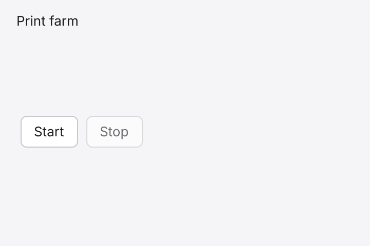

# Frames, labels, and buttons

**Live:** the Buttons card and the Labelframe card of the [gallery](https://beetlebug.org/ztk/play/index.html?example=gallery), and the [sign-in form](https://beetlebug.org/ztk/play/index.html?example=signin).

## frame, label, and button



<!-- widget: button; shot: update -->
```tcl
frame .card -padx 16 -pady 12
label .card.title -text "Print farm"
button .card.go -text "Start" -command {puts started}
button .card.off -text "Stop" -state disabled
pack .card -fill both -expand 1
pack .card.title -anchor w
pack .card.go .card.off -side left -padx 4 -pady 8
```


<!-- more: The details of button -->

- `button` has `invoke`, `flash`, `-command`, `-state`, and `-default`. A button is a `Button` in CSS.
- The theme gives the border and the padding, so `-borderwidth`, `-padx`, and `-pady` default to 0. A value of the script overrides the theme.
- `ztk::class .card.go add primary` gives a widget a style class for your stylesheet.

<!-- end more -->

## labelframe and message


<!-- widget: labelframe; shot: update -->
```tcl
labelframe .notes -text "Notes" -padx 12 -pady 6
message .notes.m -width 260 -text "A message breaks its text into lines. A labelframe puts a title above a group of widgets."
pack .notes.m -anchor w
pack .notes -fill x -padx 8 -pady 8
```

## toplevel and grab

```tcl
toplevel .about
wm title .about "About"
label .about.l -text "ztk"
button .about.ok -text "Close" -command {destroy .about}
pack .about.l .about.ok -padx 20 -pady 8
grab .about
```

Each `toplevel` has its own window and render thread. `grab` is local: `-global` acts as a local grab. In the browser, only the window `.` has a canvas.

## Tooltips

`ztk::tooltip path ?text?` shows a text when the pointer rests on a widget. The tooltip fades in and out, and its part `::tooltip` accepts CSS rules.


<!-- widget: tooltip; shot: update -->
```tcl
button .save -text "Save"
pack .save -padx 20 -pady 20
ztk::tooltip .save "Saves the document"
```
