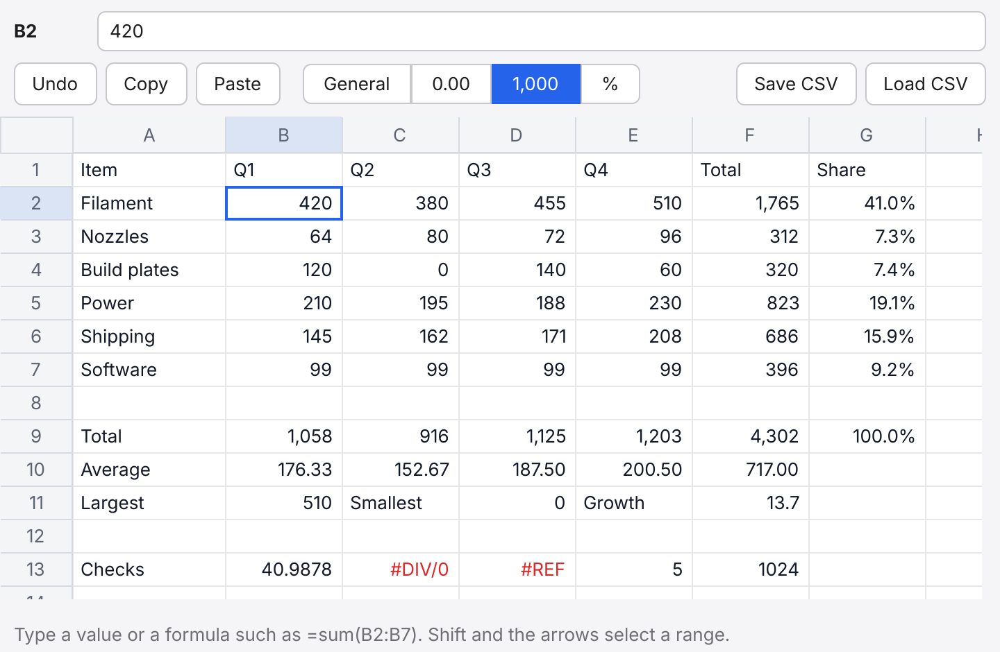
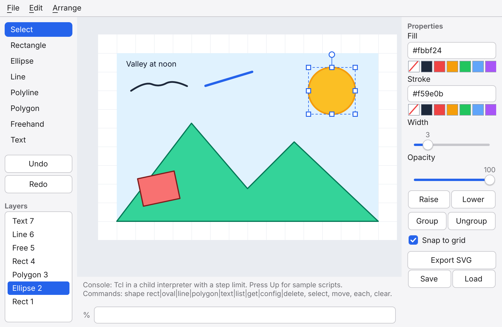

# Canvas

The canvas has every item type of Tk 8.6: `arc`, `bitmap`, `image`, `line`, `oval`, `polygon`, `rectangle`, `text`, and `window`, with tags, bindings, scrolling, and `scale`. Only `postscript` is missing.

**Live:** the Canvas card of the [gallery](https://beetlebug.org/ztk/play/index.html?example=gallery), the [spreadsheet](https://beetlebug.org/ztk/play/index.html?example=spreadsheet), and the [vector tool](https://beetlebug.org/ztk/play/index.html?example=vector).

```tcl
canvas .c -width 300 -height 110 -highlightthickness 0
pack .c -fill both -expand 1
.c create rectangle 8 10 88 66 -fill #2563eb -activefill #3b82f6 -outline {} -tags shape
.c create oval 108 8 168 68 -fill #f59e0b -outline {} -tags shape
.c create polygon 188 68 218 8 248 68 -fill #10b981 -tags shape
.c create text 12 90 -text "Drag a shape" -anchor w
.c bind shape <Button-1> {set ::xy [list %x %y]; %W raise current}
.c bind shape <B1-Motion> {
    lassign $::xy x0 y0
    %W move current [expr {%x - $x0}] [expr {%y - $y0}]
    set ::xy [list %x %y]
}
```

- `ztk::animate {.c tagOrId} -coords {...} -fill red -duration 300` moves items. See [Animation](../animation.md).
- Items that keep the default black of Tk draw with the text color of the theme, so they show in the dark scheme.
- `image create photo` reads PNG data from `-data` or a PNG file in the folder of the script.

## Showcase: the spreadsheet



[`examples/spreadsheet.tcl`](../../examples/spreadsheet.tcl) has 10 000 rows on one canvas. It makes items only for the cells in view. Formulas such as `=sum(B2:B7)` are Tcl expressions, with recalculation and cycle errors. A scroll frame uses 0.75 ms of CPU time at the median.

## Showcase: the vector tool



[`examples/vector.tcl`](../../examples/vector.tcl) draws rectangles, ellipses, lines, polygons, paths, and text, with handles that move, resize, and rotate. It has undo, groups, the z-order, zoom, and SVG export. Its console runs Tcl in a child interpreter under `ztk::limit`, a step and memory limit for one script.
