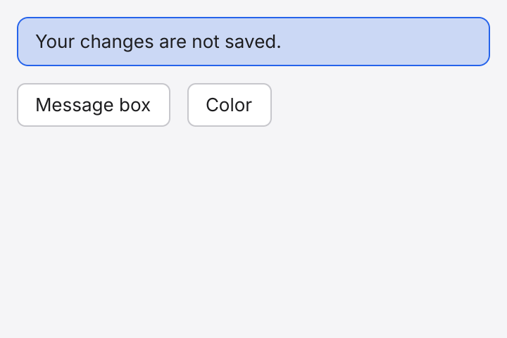

# Dialogs

**Live:** the [playground](https://beetlebug.org/ztk/play/index.html) runs the example below.

## The dialogs and ztk::toast



<!-- widget: dialogs; shot: update -->
```tcl
frame .banner
label .banner.l -text "Your changes are not saved."
pack .banner.l -anchor w
ztk::class .banner add banner
button .ask -text "Message box" -command {
    set r [tk_messageBox -message "Save the changes?" -detail "The changes are lost when you close the window." -type yesnocancel -icon question]
    ztk::toast "You chose $r"
}
button .color -text "Color" -command {
    set c [tk_chooseColor -initialcolor #2563eb]
    if {$c ne ""} { .banner configure -background $c }
}
pack .banner -fill x -padx 12 -pady 12
pack .ask .color -side left -anchor n -padx {12 0}
```

- `tk_messageBox` has the options, the types, the icons, and the results of `messageBox.n`. Return invokes the button with the focus, and Escape gives `cancel`, or `no`, `abort`, or `ok` when the type has no cancel button.
- `tk_dialog` gives the number of the button, or -1 when the window closes.
- `tk_chooseColor` has a grid of swatches, sliders for red, green, and blue, and a hex field. It gives a color such as `#2563eb`, or an empty string for a cancel.
- `tk_getOpenFile`, `tk_getSaveFile`, and `tk_chooseDirectory` list the folders and the files, with the filters of `-filetypes`. They need the file capability of the program. On Windows and macOS they are the dialogs of the system.
- Each dialog is a toplevel of the class `Dialog` with a grab, and it fades in.
- `ztk::toast text ?-duration ms?` shows a short message at the bottom of the window. It slides in, stays for 2,500 ms by default, and slides out. The style class `banner` gives a frame the look of a message in the page.
