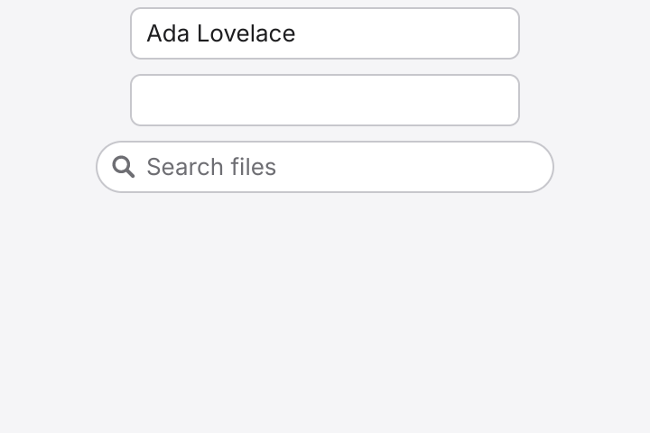

# Entry and spinbox

**Live:** the Text input card of the [gallery](https://beetlebug.org/ztk/play/index.html?example=gallery).

## entry



<!-- widget: entry; shot: update -->
```tcl
set name "Ada Lovelace"
entry .name -textvariable name -width 22
entry .pw -show * -width 22
entry .search -width 22 -placeholder "Search files"
ztk::class .search add search
pack .name .pw .search -padx 12 -pady 4
```

### Play: Cellar Door

Cellar Door is a text adventure, and an entry is its prompt. Type a line and press Return: the `<Return>` binding reads `-textvariable cmd` and runs the line. The Up and Down keys of the entry step through the lines that ran, and `-validatecommand` keeps a line to 32 characters. The canvas is the map, and the hero walks from room to room. Try `help`, `look`, `go east`, `take key`, and `open gate`. On the handheld, Up and Down step through the lines, A runs the line, and B clears it. With "Play on the page" on, `throw stone` sends the stone out of the map, and it bounces off the headings and the code before it comes back.

<!-- widget: toy-cellardoor; shot: update -->
```tcl
# Cellar Door: a text adventure. The entry is the prompt, and the canvas is the map.
set ink {#1d1a33 #f2e6c4 #ef5b5b #ffcf5c #3a3560}
canvas .c -width 360 -height 172 -bg [lindex $ink 0] -highlightthickness 0
label .p -text ">" -font {TkFixedFont 12 bold}
entry .cmd -textvariable cmd -font TkFixedFont -validate key -validatecommand {expr {[string length %P] <= 32}}
pack .c -fill x
pack .p -side left -padx {8 0}
pack .cmd -side left -fill x -expand 1 -padx 8 -pady 8
array set toy {spill 0 out {} back {} sfx {}}
# Each room: its place on the map and its exits.
set rooms {
    garden {0 0 {e shed n gate}}
    shed   {1 0 {w garden s hall}}
    cellar {0 1 {e hall}}
    hall   {1 1 {w cellar n shed}}
}
proc box {room} { lassign [dict get $::rooms $room] c r; list [expr {8+$c*176}] [expr {6+$r*76}] }
foreach room [dict keys $rooms] {
    lassign [box $room] x y
    .c create rectangle $x $y [expr {$x+168}] [expr {$y+68}] -fill [lindex $ink 4] -width 0
    .c create rectangle [expr {$x+4}] [expr {$y+4}] [expr {$x+164}] [expr {$y+64}] -fill [lindex $ink 0] -width 0
    .c create text [expr {$x+10}] [expr {$y+12}] -anchor w -text [string toupper $room] -fill [lindex $ink 4] -font {TkFixedFont 9 bold}
}
# The doors are gaps in the walls, and the gate is gold until it opens.
foreach {x0 y0 x1 y1} {172 30 188 44  264 70 278 86  172 106 188 120} { .c create rectangle $x0 $y0 $x1 $y1 -fill [lindex $ink 0] -width 0 }
.c create rectangle 70 4 104 10 -tags gate -fill [lindex $ink 3] -width 0
.c create text 180 164 -tags out -fill [lindex $ink 1] -font {TkFixedFont 10} -width 340
proc sprite {tags rows color x0 y0} {
    foreach row $rows {
        set x $x0
        foreach ch [split $row ""] {
            if {$ch eq "#"} { .c create rectangle $x $y0 [expr {$x+2}] [expr {$y0+2}] -tags $tags -fill $color -width 0 }
            incr x 2
        }
        incr y0 2
    }
}
sprite hero {..##.. ..##.. .####. #.##.# ..##.. .#..#. .#..#.} [lindex $ink 2] 0 0
sprite key {.##.... #..#### .##.#.#} [lindex $ink 3] 300 40
sprite stone {.##. ####  .##.} [lindex $ink 1] 120 120
array set g {hx 0 hy 0 tx 0 ty 0 hist {} at 0}
proc new {} {
    global g
    array set g {room cellar bag {} open 0}
    .c itemconfigure key -state normal; .c itemconfigure stone -state normal
    .c itemconfigure gate -fill [lindex $::ink 3]
    walk cellar
    tell "You wake in a cellar. Type help."
}
proc tell {text} { .c itemconfigure out -text $text }
proc walk {room} { global g; set g(room) $room; lassign [box $room] x y; set g(tx) [expr {$x+76}]; set g(ty) [expr {$y+36}] }
# The parser: the first word is the verb, and the last word is the thing.
proc run {line} {
    global g toy
    set w [string tolower [string trim $line]]
    set verb [lindex $w 0]; set thing [lindex $w end]
    if {$verb eq "go"} { set verb $thing }
    set verb [string map {north n south s east e west w} $verb]
    set here [lindex [dict get $::rooms $g(room)] 2]
    switch -- $verb {
        n - s - e - w {
            if {![dict exists $here $verb]} { tell "A wall."; return }
            set to [dict get $here $verb]
            if {$to ne "gate"} { walk $to; tell "You go to the [string totitle $to]."; return }
            if {!$g(open)} { tell "The gate is locked." } else { set g(ty) -20; tell "You are free! Type new to play again."; lappend toy(sfx) point }
        }
        take {
            set has [dict get {key shed stone cellar} $thing]
            if {$has ne $g(room) || $thing in $g(bag)} { tell "There is no $thing here."; return }
            lappend g(bag) $thing; .c itemconfigure $thing -state hidden; tell "You take the $thing."; lappend toy(sfx) hit
        }
        open {
            if {$g(room) ne "garden" || "key" ni $g(bag)} { tell "It does not open."; return }
            set g(open) 1; .c itemconfigure gate -fill [lindex $::ink 0]; tell "The key turns. The gate is open."
        }
        throw {
            if {"stone" ni $g(bag)} { tell "You have no stone."; return }
            if {!$toy(spill)} { tell "The stone hits the ceiling and drops."; lappend toy(sfx) wall; return }
            # With play on the page, the stone flies out of the map and over the page.
            set toy(out) [list $g(hx) $g(hy) 6 -12 0.4]; lappend toy(sfx) smash
            set g(bag) [lsearch -all -inline -not $g(bag) stone]; tell "The stone flies out of the map!"
        }
        look { tell "The [string totitle $g(room)]. Exits: [join [dict keys $here] {, }]." }
        bag - inventory { tell [expr {$g(bag) eq "" ? "Your bag is empty." : "You have: [join $g(bag) {, }]."}] }
        new { new }
        help { tell "Try: look, go east, take key, open gate, throw stone, bag." }
        default { tell "You cannot $verb here." }
    }
}
# Return runs the line. Up and Down step through the lines that ran.
bind .cmd <Return> { lappend g(hist) $cmd; set g(at) [llength $g(hist)]; run $cmd; set cmd "" }
proc toy_press {key} {
    global g cmd
    switch $key {
        up { set g(at) [expr {max(0, $g(at)-1)}]; set cmd [lindex $g(hist) $g(at)] }
        down { set g(at) [expr {min([llength $g(hist)], $g(at)+1)}]; set cmd [lindex $g(hist) $g(at)] }
        a { event generate .cmd <Return> }
        b { set cmd "" }
    }
    .cmd icursor end
}
bind .cmd <Up> {toy_press up}
bind .cmd <Down> {toy_press down}
focus .cmd
proc tick {} {
    global g toy
    # The hero walks to the room in steps of 2 pixels.
    foreach a {x y} { set d [expr {$g(t$a) - $g(h$a)}]; set s($a) [expr {$d > 0 ? min(2, $d) : max(-2, $d)}] }
    .c move hero $s(x) $s(y)
    incr g(hx) $s(x); incr g(hy) $s(y)
    if {$toy(back) ne ""} {
        lappend g(bag) stone; tell "The stone comes back. It hit [lindex $toy(back) 3] things out there."
        set toy(back) {}
    }
    after 16 tick
}
new
array set g [list hx $g(tx) hy $g(ty)]
.c move hero $g(hx) $g(hy)
tick
```

- `-placeholder` and `-placeholderforeground` show a hint in an empty entry. They are the names of Tk 8.7.
- The style class `search` adds a search icon and a clear button.
- Undo and redo: Control-z, Control-Shift-z, and Control-y, or `event generate .name <<Undo>>`. A run of typed text is one step.
- Cut, copy, and paste use the `clipboard` command. In this version the clipboard is local to the app.
- `xview` and `-xscrollcommand` connect an entry to a [scrollbar](range.md).

## Validation

Validation follows Tk: the modes, the `%` fields, and `-invalidcommand`.

<!-- live -->
```tcl
entry .qty -validate key -validatecommand {string is integer %P} -invalidcommand bell
pack .qty -padx 12 -pady 4
```

## spinbox


<!-- widget: spinbox; shot: update -->
```tcl
spinbox .copies -from 1 -to 99 -width 6
spinbox .size -values {Small Medium Large} -state readonly -width 10
.size set Medium
pack .copies .size -padx 12 -pady 4
```

A spinbox has `-format`, `-wrap`, `-command`, and the repeat of a held button. The buttons are the parts `::buttonup` and `::buttondown` in CSS.
