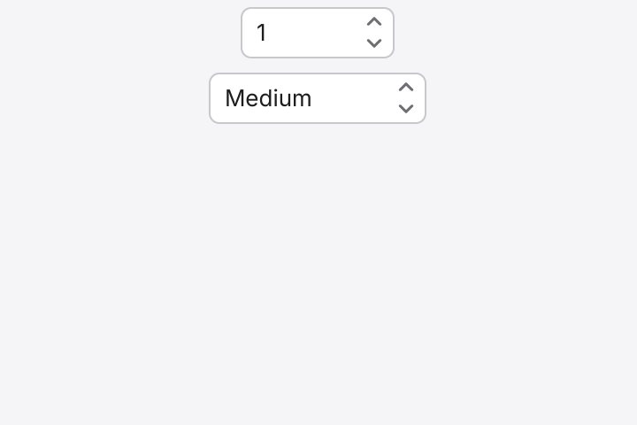

# Entry and spinbox

**Live:** the Text input card of the [gallery](https://beetlebug.org/ztk/play/index.html?example=gallery).

## entry


<!-- widget: entry; shot: update -->
```tcl
set name "Ada Lovelace"
entry .name -textvariable name -width 22
entry .pw -show * -width 22
entry .search -width 22 -placeholder "Search files"
ztk::class .search add search
pack .name .pw .search -padx 12 -pady 4
```


- `-placeholder` and `-placeholderforeground` show a hint in an empty entry. They are the names of Tk 8.7.
- The style class `search` adds a search icon and a clear button.
- Undo and redo: Control-z, Control-Shift-z, and Control-y, or `event generate .name <<Undo>>`. A run of typed text is one step.
- Cut, copy, and paste use the `clipboard` command. In this version the clipboard is local to the app.
- `xview` and `-xscrollcommand` connect an entry to a [scrollbar](range.md).
- Left, Right, Backspace, and Delete move and delete by grapheme cluster (Unicode UAX #29), and a double click selects a word of UAX #29. The index of an entry still counts characters, as in Tk.

## Validation

Validation follows Tk: the modes, the `%` fields, and `-invalidcommand`.

<!-- live -->
```tcl
entry .qty -validate key -validatecommand {string is integer %P} -invalidcommand bell
pack .qty -padx 12 -pady 4
```

## spinbox



<!-- widget: spinbox; shot: update -->
```tcl
spinbox .copies -from 1 -to 99 -width 6
spinbox .size -values {Small Medium Large} -state readonly -width 10
.size set Medium
pack .copies .size -padx 12 -pady 4
```

A spinbox has `-format`, `-wrap`, `-command`, and the repeat of a held button. The buttons are the parts `::buttonup` and `::buttondown` in CSS.
