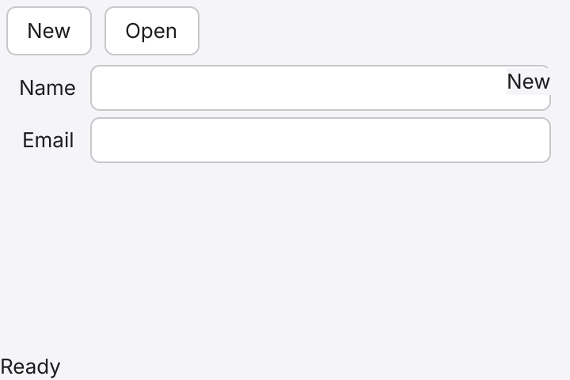

# pack, grid, and place

ztk has the three geometry managers of Tk, with all their subcommands and options. CSS has no layout properties in ztk: the geometry managers place each widget.

**Live:** each example uses them. The [calculator](https://beetlebug.org/ztk/play/index.html?example=calculator) is one `grid`, and the [gallery](https://beetlebug.org/ztk/play/index.html?example=gallery) mixes `pack` and `grid`.



<!-- widget: geometry; shot: update -->
```tcl
# pack: a toolbar at the top, a status line at the bottom.
frame .bar
button .bar.new -text New
button .bar.open -text Open
pack .bar.new .bar.open -side left -padx 4
pack .bar -side top -fill x -pady 4
label .status -text Ready -anchor w
pack .status -side bottom -fill x

# grid: a form with a column that grows.
frame .form
label .form.l1 -text Name
entry .form.e1
label .form.l2 -text Email
entry .form.e2
grid .form.l1 .form.e1 -sticky ew -padx 4 -pady 2
grid .form.l2 .form.e2 -sticky ew -padx 4 -pady 2
grid columnconfigure .form 1 -weight 1
pack .form -fill both -expand 1 -padx 8

# place: a badge in the corner of the form.
label .badge -text New
place .badge -in .form -relx 1.0 -x -4 -y 4 -anchor ne
```

A comparison tool runs random layouts in ztk and in `wish` 8.6.16. `pack` and `place` gave the same result in each run. `grid` differs by one pixel in a few rare layouts with overlapping spans. A distance with a unit (`1c`) uses 96 / 72 pixels in a point.
