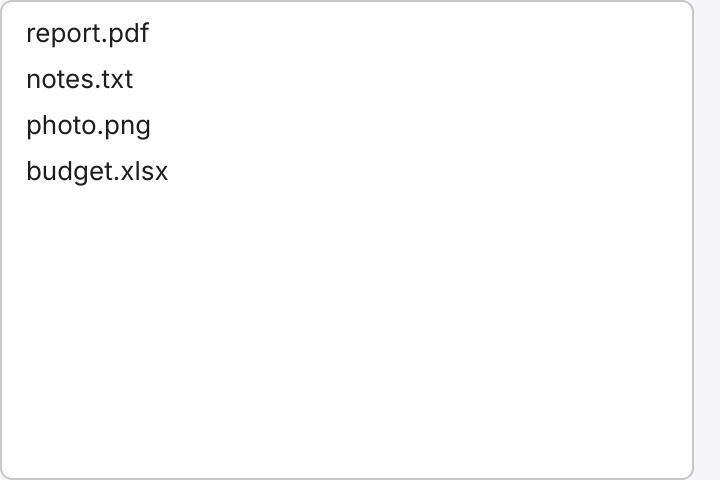

# Listbox

**Live:** the Lists card of the [gallery](https://beetlebug.org/ztk/play/index.html?example=gallery), and the layer list of the [vector tool](https://beetlebug.org/ztk/play/index.html?example=vector).

## listbox



<!-- widget: listbox; shot: update -->
```tcl
listbox .files -height 6 -selectmode extended -yscrollcommand {.sb set} -emptytext "No files"
scrollbar .sb -command {.files yview}
.files insert end report.pdf notes.txt photo.png budget.xlsx
bind .files <<ListboxSelect>> {puts [.files curselection]}
pack .files -side left -fill both -expand 1
pack .sb -side right -fill y

listbox .side -height 4 -activestyle none
.side insert end Inbox Drafts Sent Archive
ztk::class .side add sidebar
```

### Play: Skate Pond

Skate Pond is a puzzle on ice, and the listbox picks the level. A selection sends `<<ListboxSelect>>`, and the binding builds the board: its rows drop in one after the other. The arrow keys, or the pad with B for left and A for right, push the skater, and the skater slides until a rock stops it. Reach the gold flag. The game then gives the row of the level a gold `-foreground` with `itemconfigure` and selects the next row with `selection set` and `see`. A gap in the wall is a way off the ice. With "Play on the page" on, the skater slides out across the page and bounces off the headings and the code, and then comes back to the start. Escape or a scroll brings the skater back at once.

<!-- widget: toy-skatepond; shot: update -->
```tcl
# Skate Pond: the listbox picks the level, and a skater slides on the ice to the flag.
set ink {#1d1a33 #f2e6c4 #ef5b5b #ffcf5c #3a3560}
set maps {
    "Two Rocks" {########### #.....#..S# #.#.......# #.........# #....F#...# #.........# #........## ###.#######}
    "Side Door" {########### #.........# #.........# ..........# ##.....#..# #S.##...F.# #...#....## ###########}
    "Cold Snap" {########### #S#.......# #....#..#.# #......#..# #...#..#..# ##....#...# #.#..F....# ##..#######}
    "Thin Ice" {########### #S....#...# #.........# #...#.....# #.........# #.#.....F.# #......#..# #####.#####}
    "Long Way" {#######.### #.........# #.......#.. #.F.....### #..#.#..#.# ##...#.#.S# #....#....# ###########}
}
set names [dict keys $maps]
listbox .levels -listvariable names -height 5 -width 9 -exportselection 0 -activestyle none
canvas .c -width 220 -height 176 -bg [lindex $ink 0] -highlightthickness 0
pack .levels -side left -fill y -padx 8 -pady 8
pack .c -side left -pady 8
.c create text 110 168 -tags msg -fill [lindex $ink 3] -font {TkFixedFont 11 bold}
array set toy {spill 0 out {} back {} sfx {}}
array set b {cx 0 cy 0 dx 0 dy 0 x 0 y 0 drop 99 moves 0 t 0}
# A sprite is rows of text: each # is a square of 2 pixels.
proc sprite {tags rows color x0 y0} {
    foreach row $rows {
        set x $x0
        foreach ch [split $row ""] {
            if {$ch eq "#"} { .c create rectangle $x $y0 [expr {$x+2}] [expr {$y0+2}] -tags $tags -fill $color -width 0 }
            incr x 2
        }
        incr y0 2
    }
}
# A selection builds the board. Each row starts 160 pixels high and drops in.
proc load {{drop 1}} {
    global maps b grid
    set name [.levels get [lindex [.levels curselection] 0]]
    set grid [dict get $maps $name]
    .c delete board
    for {set r 0} {$r < 8} {incr r} {
        for {set i 0} {$i < 11} {incr i} {
            set x [expr {$i*20}]; set y [expr {$r*20 - ($drop ? 160 : 0)}]
            switch [string index [lindex $grid $r] $i] {
                "#" { .c create rectangle $x $y [expr {$x+20}] [expr {$y+20}] -tags "board r$r" -fill [lindex $::ink 4] -width 0
                      .c create rectangle $x $y [expr {$x+20}] [expr {$y+2}] -tags "board r$r" -fill [lindex $::ink 1] -width 0 }
                F { # The flag has two frames, and tick shows one at a time.
                    sprite "board r$r flag0" {#..... ####.. ###### ####.. #..... #..... #.....} [lindex $::ink 3] [expr {$x+5}] [expr {$y+3}]
                    sprite "board r$r flag1" {#..... #.##.. ###### #.###. #..... #..... #.....} [lindex $::ink 3] [expr {$x+5}] [expr {$y+3}] }
                S { array set b [list cx $i cy $r sx $i sy $r] }
                default { .c create rectangle [expr {$x+9}] [expr {$y+9}] [expr {$x+11}] [expr {$y+11}] -tags "board r$r" -fill [lindex $::ink 4] -width 0 }
            }
        }
    }
    array set b [list dx 0 dy 0 drop [expr {$drop ? 0 : 99}] moves 0]
    place_skater
    .c itemconfigure msg -text ""
    focus .c
}
proc place_skater {} {
    global b
    .c delete skater
    set b(x) [expr {$b(cx)*20}]; set b(y) [expr {$b(cy)*20}]
    sprite skater {..##.. .####. ##..## .####. ..##.. .#..#. ##..##} [lindex $::ink 2] [expr {$b(x)+4}] [expr {$b(y)+3}]
    .c raise skater
}
bind .levels <<ListboxSelect>> load
proc toy_press {key} {
    global b
    if {$b(dx) || $b(dy) || $b(drop) < 30} return
    lassign [dict get {up {0 -1} down {0 1} a {1 0} b {-1 0} right {1 0} left {-1 0}} $key] b(dx) b(dy)
    incr b(moves)
}
foreach k {Up Down Left Right} { bind .c <$k> [list toy_press [string tolower $k]] }
proc tick {} {
    global b toy grid names
    incr b(t)
    .c itemconfigure flag[expr {$b(t) / 16 % 2}] -state normal
    .c itemconfigure flag[expr {($b(t) / 16 + 1) % 2}] -state hidden
    # The drop: row r lands 2 frames after row r-1.
    if {$b(drop) < 30} {
        incr b(drop)
        for {set r 0} {$r < 8} {incr r} {
            set off [expr {max(0, 160 - 16 * ($b(drop) - 2*$r))}]
            set prev [expr {max(0, 160 - 16 * ($b(drop) - 1 - 2*$r))}]
            .c move r$r 0 [expr {$prev - $off}]
        }
    }
    if {($b(dx) || $b(dy)) && $toy(out) eq ""} {
        .c move skater [expr {5*$b(dx)}] [expr {5*$b(dy)}]
        incr b(x) [expr {5*$b(dx)}]; incr b(y) [expr {5*$b(dy)}]
        if {$b(x) % 20 == 0 && $b(y) % 20 == 0} {
            set b(cx) [expr {$b(x)/20}]; set b(cy) [expr {$b(y)/20}]
            set nx [expr {$b(cx)+$b(dx)}]; set ny [expr {$b(cy)+$b(dy)}]
            set here [string index [lindex $grid $b(cy)] $b(cx)]
            set next [expr {$nx < 0 || $ny < 0 || $nx > 10 || $ny > 7 ? "out" : [string index [lindex $grid $ny] $nx]}]
            if {$here eq "F"} {
                set i [lindex [.levels curselection] 0]
                .levels itemconfigure $i -foreground [lindex $::ink 3]
                .c itemconfigure msg -text "CLEAR IN $b(moves)"; lappend toy(sfx) point
                array set b {dx 0 dy 0}
                set i [expr {($i + 1) % [llength $names]}]
                after 900 [list .levels selection clear 0 end]
                after 900 [list .levels selection set $i]
                after 900 [list .levels see $i]
                after 900 load
            } elseif {$next eq "#"} { array set b {dx 0 dy 0}; lappend toy(sfx) wall
            } elseif {$next eq "out"} {
                # Off the ice: with play on the page, the skater slides across the page.
                if {$toy(spill)} {
                    set toy(out) [list [expr {[winfo x .c] + $b(x) + 8}] [expr {[winfo y .c] + $b(y) + 8}] [expr {8*$b(dx)}] [expr {8*$b(dy)}]]
                    lappend toy(sfx) smash
                } else { array set b [list dx 0 dy 0 cx $b(sx) cy $b(sy)]; place_skater; .c itemconfigure msg -text "SPLASH"; lappend toy(sfx) hit }
            }
        }
    }
    # The page gives the skater back at the start.
    if {$toy(back) ne ""} {
        array set b [list dx 0 dy 0 cx $b(sx) cy $b(sy)]; place_skater
        .c itemconfigure msg -text "BOUNCED [lindex $toy(back) 3] TIMES"
        set toy(back) {}
    }
    after 16 tick
}
.levels selection set 0
load 0
tick
```

- The listbox has the options, the subcommands, and the four selection modes of Tk 8.6: `single`, `browse`, `multiple`, and `extended`. The pointer and the keys select rows as in `wish`, and a change by the user sends `<<ListboxSelect>>`.
- `-listvariable` links the rows to a list variable in both directions.
- When the selection moves from one row to another row, its background eases between the rows in 180 ms.
- A scroll eases, and a touchpad scrolls by pixels with momentum. A whole step of `yview scroll` or `yview moveto` puts a row at the top, as in Tk.
- The additions: `-emptytext` shows a text in an empty listbox, and the style class `sidebar` gives a list with no field and round accent rows.
- The parts `::item`, `::selection`, `::active`, and `::empty` accept CSS rules.
