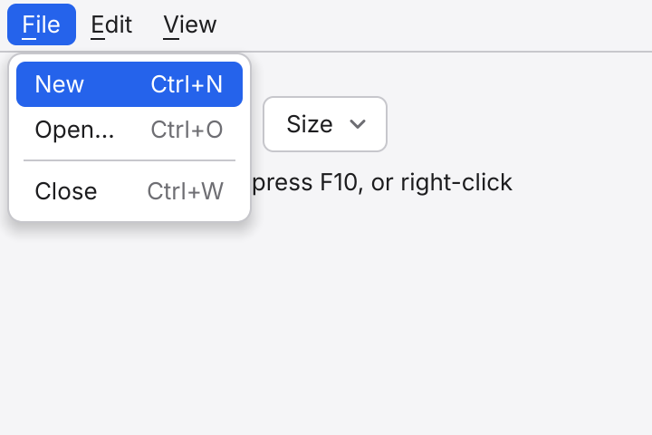

# Menus

**Live:** the Menus card of the [gallery](https://beetlebug.org/ztk/play/index.html?example=gallery).

## menu, menubutton, and ttk::menubutton



<!-- widget: menu; shot: event generate . <Key-F10> -->
```tcl
menu .bar
. configure -menu .bar
foreach {name text} {file File edit Edit view View} {
    menu .bar.$name -tearoff 0
    .bar add cascade -label $text -menu .bar.$name -underline 0
}
.bar.file add command -label New -accelerator Ctrl+N -command {set status New}
.bar.file add command -label Open... -accelerator Ctrl+O -command {set status Open}
.bar.file add separator
.bar.file add command -label Close -accelerator Ctrl+W -command {set status Close}
.bar.edit add command -label Undo -accelerator Ctrl+Z -command {set status Undo}
.bar.edit add command -label Redo -state disabled
.bar.view add checkbutton -label "Show grid" -variable grid
.bar.view add radiobutton -label Small -variable size -value small
.bar.view add radiobutton -label Large -variable size -value large
set grid 1
set size small
set status "Click File, press F10, or right-click"
ttk::menubutton .mb -text Size -menu .bar.view
label .status -textvariable status
pack .mb -pady {24 8}
pack .status
bind . <Button-3> {tk_popup .bar.edit %X %Y}
```

- `menu` has the five entry types of Tk 8.6 (`command`, `cascade`, `checkbutton`, `radiobutton`, and `separator`), the tearoff entry, and the subcommands and the messages of `wish` 8.6.16. `invoke` sets the variable of a check or radio entry and then runs `-command`. A change of the active entry sends `<<MenuSelect>>`.
- `toplevel -menu` gives the window a menu bar. On Linux and the web, ztk draws the bar as a row at the top of the window, as Tk on X11 does. The content of the window goes below the row. macOS and Windows show their own menus.
- `tk_popup` and `post` show a menu at a point of the window. A cascade opens on the right of its entry, or on the left when the window has no room. A menu that does not fit moves into the window.
- `menubutton` and `ttk::menubutton` post their `-menu` on the side of `-direction`. A drag from the button to an entry and a release there invokes the entry.
- The pointer: motion activates an entry and opens a cascade, a release invokes the entry, and a press outside the menus closes them.
- The keys: `Up` and `Down` move the active entry, `Right` opens a cascade, `Left` closes it, and `Return` or `space` invokes the entry. `Escape` closes the menu. The letter of `-underline` invokes its entry. On the menu bar, `F10` opens the first menu, `Alt` with a letter opens the menu with that `-underline` letter, and `Left` and `Right` move along the bar.
- A menu opens with a fade and a slide of 6 logical pixels in 150 ms, and fades out in 150 ms after it closes. The moves run on the render thread. The highlight of the active entry eases from one entry to the next in 120 ms.
- The parts `::item`, `::item-active`, `::separator`, `::accelerator`, and `::indicator` of the class `Menu` accept CSS rules, and so do `::bar`, `::bar-item`, and `::bar-item-active` for the menu bar row. `Menubutton::indicator` is the chevron of a menu button.
