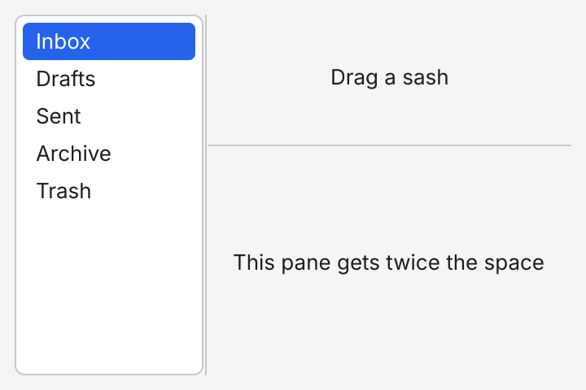

# Panes

**Live:** the Panes card of the [gallery](https://beetlebug.org/ztk/play/index.html?example=gallery).

## panedwindow and ttk::panedwindow



<!-- widget: panedwindow; shot: update -->
```tcl
panedwindow .p
listbox .p.list -width 10
.p.list insert end Inbox Drafts Sent Archive Trash
.p.list selection set 0
ttk::panedwindow .p.right -orient vertical
label .p.right.mail -text "Drag a sash"
label .p.right.info -text "This pane gets twice the space"
.p.right add .p.right.mail -weight 1
.p.right add .p.right.info -weight 2
.p add .p.list -stretch never
.p add .p.right -stretch always
pack .p -fill both -expand 1 -padx 8 -pady 8
```

- `panedwindow` puts its panes in a row (`-orient horizontal`) or a column, with a sash between two panes. It has the options, the pane options, and the subcommands of Tk 8.6: `add`, `forget`, `identify`, `panecget`, `paneconfigure`, `panes`, `proxy`, and `sash` with `coord`, `dragto`, `mark`, and `place`.
- A pane has the size of its widget, or its `-width` or `-height`, plus `-padx` or `-pady`. `-sticky` places the widget in its pane. `-stretch` picks the panes that get the extra space, or lose space, when the panedwindow changes size. A sash move stops at the `-minsize` of the panes.
- `ttk::panedwindow` has `add`, `forget`, `identify`, `insert`, `pane`, `panes`, and `sashpos`. A change of the size goes to the panes in proportion to their `-weight`. `sashpos` puts a sash between its neighbors and pushes them when it must.
- A press on a sash and a drag move it. The panes follow the pointer in each frame, and the render thread moves the sash with the pointer while a script is busy. With `-opaqueresize 0`, a drag moves a line, and the release moves the sash. `-showhandle` draws a handle on each sash.
- The pointer shape is a resize arrow over a sash, or the shape of `-sashcursor`.
- The modern theme draws a sash as a thin line in the part `::sash`. The sash under the pointer or in a drag fades to the part `::sash-active` in 120 ms.
