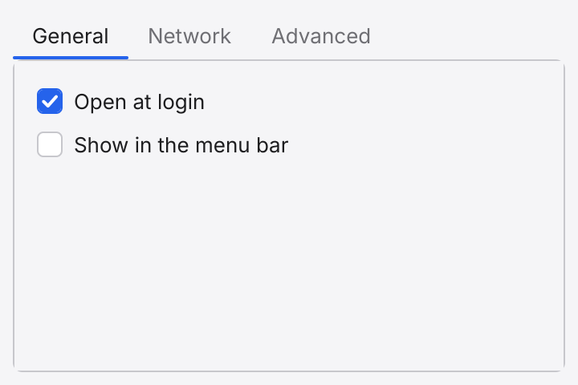

# Panes and tabs

**Live:** the Panes and Tabs cards of the [gallery](https://beetlebug.org/ztk/play/index.html?example=gallery).

## panedwindow and ttk::panedwindow


<!-- widget: panedwindow; shot: update -->
```tcl
panedwindow .p
listbox .p.list -width 10
.p.list insert end Inbox Drafts Sent Archive Trash
.p.list selection set 0
ttk::panedwindow .p.right -orient vertical
label .p.right.mail -text "Drag a sash"
label .p.right.info -text "This pane gets twice the space"
.p.right add .p.right.mail -weight 1
.p.right add .p.right.info -weight 2
.p add .p.list -stretch never
.p add .p.right -stretch always
pack .p -fill both -expand 1 -padx 8 -pady 8
```

- `panedwindow` puts its panes in a row (`-orient horizontal`) or a column, with a sash between two panes. It has the options, the pane options, and the subcommands of Tk 8.6: `add`, `forget`, `identify`, `panecget`, `paneconfigure`, `panes`, `proxy`, and `sash` with `coord`, `dragto`, `mark`, and `place`.
- A pane has the size of its widget, or its `-width` or `-height`, plus `-padx` or `-pady`. `-sticky` places the widget in its pane. `-stretch` picks the panes that get the extra space, or lose space, when the panedwindow changes size. A sash move stops at the `-minsize` of the panes.
- `ttk::panedwindow` has `add`, `forget`, `identify`, `insert`, `pane`, `panes`, and `sashpos`. A change of the size goes to the panes in proportion to their `-weight`. `sashpos` puts a sash between its neighbors and pushes them when it must.
- A press on a sash and a drag move it. The panes follow the pointer in each frame, and the render thread moves the sash with the pointer while a script is busy. With `-opaqueresize 0`, a drag moves a line, and the release moves the sash. `-showhandle` draws a handle on each sash.
- The pointer shape is a resize arrow over a sash, or the shape of `-sashcursor`.
- The modern theme draws a sash as a thin line in the part `::sash`. The sash under the pointer or in a drag fades to the part `::sash-active` in 120 ms.

## ttk::notebook



<!-- widget: notebook; shot: update -->
```tcl
ttk::notebook .n
foreach {page title} {general General network Network advanced Advanced} {
    ttk::frame .n.$page -padding 12
    .n add .n.$page -text $title -underline 0
}
set login 1
set menubar 0
ttk::checkbutton .n.general.a -text "Open at login" -variable login
ttk::checkbutton .n.general.b -text "Show in the menu bar" -variable menubar
pack .n.general.a .n.general.b -anchor w -pady 2
ttk::label .n.network.l -text "Proxy: none"
pack .n.network.l -anchor w
.n tab .n.advanced -state disabled
ttk::notebook::enableTraversal .n
pack .n -fill both -expand 1 -padx 8 -pady 8
```

- `ttk::notebook` has the subcommands of Tk 8.6: `add`, `forget`, `hide`, `identify`, `index`, `insert`, `select`, `tab`, and `tabs`, with `instate` and `state`. A tab is `normal`, `disabled`, or `hidden`, and it has `-text`, `-underline`, `-padding`, and `-sticky`.
- A click on a tab selects it. `Left` and `Right` move to the next tab that is not disabled, and `Control-Tab` and `Control-Shift-Tab` cycle the tabs. `ttk::notebook::enableTraversal` adds these keys to the whole window, with `Control-Page Up`, `Control-Page Down`, and `Alt` with the letter of `-underline`.
- Each change of the selected tab sends `<<NotebookTabChanged>>` after the script that made the change.
- The line under the selected tab slides to the new tab in 200 ms, and the new page fades in over 150 ms. A change during the slide starts from the shown place.
- The parts `::tab`, `::tab-selected`, `::tab-hover`, `::tab-disabled`, `::indicator`, and `::client` of `TNotebook` accept CSS rules.

### Play: Lamplighter

Lamplighter is a platform game, and each tab of a `ttk::notebook` is one scene of its world: Forest, Lake, and Tower. Left and Right walk, and Up or Space jumps. On the handheld, B and A walk and Up jumps. At the right edge of a scene, the game calls `.nb select` with the next tab, and at the left edge with the tab before it. A click on a tab sends `<<NotebookTabChanged>>`, and the binding puts the hero in that scene. Light the lamp of each scene: `.nb tab` then adds "(lit)" to the text of its tab. The red spring at the top of the Tower throws the hero up. With "Play on the page" on, the hero flies out of the scene, bounces off the headings and the code, and drops back in.

<!-- widget: toy-lamplighter; shot: update -->
```tcl
# Lamplighter: each tab of the notebook is a scene of one world.
set ink {#1d1a33 #f2e6c4 #ef5b5b #ffcf5c #3a3560}
ttk::notebook .nb
pack .nb -fill both -expand 1 -padx 6 -pady 6
# Each scene: a name, the tops of its blocks {x0 y x1}, its lamp, and a spring.
set scenes {
    Forest {{0 130 360} {70 100 130} {170 76 230} {270 100 330}} {200 60} {}
    Lake   {{0 130 110} {250 130 360} {130 96 170} {190 70 230}} {205 54} {}
    Tower  {{0 130 360} {40 100 100} {130 76 190} {220 52 280}} {300 112} {250 52}
}
set i 0
foreach {name blocks lamp spring} $scenes {
    set c .nb.s$i
    canvas $c -width 340 -height 150 -bg [lindex $ink 0] -highlightthickness 0
    .nb add $c -text $name
    for {set k 0} {$k < 14} {incr k} { set x [expr {($k * 97 + $i * 41) % 340}]; set y [expr {($k * 53) % 60}]; $c create rectangle $x $y [expr {$x+2}] [expr {$y+2}] -fill [lindex $ink 4] -width 0 }
    if {$name eq "Lake"} { $c create rectangle 110 140 250 400 -fill [lindex $ink 4] -width 0; for {set x 114} {$x < 250} {incr x 12} { $c create rectangle $x 138 [expr {$x+6}] 140 -fill [lindex $ink 1] -width 0 } }
    foreach b $blocks { lassign $b x0 y x1; $c create rectangle $x0 $y $x1 400 -fill [lindex $ink 4] -width 0; $c create rectangle $x0 $y $x1 [expr {$y+2}] -fill [lindex $ink 1] -width 0 }
    lassign $lamp lx ly
    $c create rectangle [expr {$lx+3}] [expr {$ly+8}] [expr {$lx+5}] [expr {$ly+18}] -fill [lindex $ink 4] -width 0
    $c create rectangle $lx $ly [expr {$lx+8}] [expr {$ly+8}] -tags lamp -fill [lindex $ink 4] -outline [lindex $ink 1]
    if {$spring ne ""} { lassign $spring sx sy; $c create rectangle $sx [expr {$sy-4}] [expr {$sx+12}] $sy -fill [lindex $ink 2] -width 0 }
    # The hero: each # of a row is a square of 2 pixels.
    set y 0
    foreach row {.##. .##. #### .##. .##. #..#} {
        set x 0
        foreach ch [split $row ""] { if {$ch eq "#"} { $c create rectangle $x $y [expr {$x+2}] [expr {$y+2}] -tags hero -fill [lindex $ink 3] -width 0 }; incr x 2 }
        incr y 2
    }
    $c itemconfigure hero -state hidden
    incr i
}
array set toy {spill 0 out {} back {} sfx {}}
array set h {x 10 y 118 vx 0 vy 0 scene 0 out 0 next 10}
array set hold {left 0 right 0}
# A click on a tab moves the hero to the left side of that scene.
bind .nb <<NotebookTabChanged>> { enter [.nb index current] $h(next); set h(next) 10 }
proc enter {n x} {
    global h
    .nb.s$h(scene) itemconfigure hero -state hidden
    set h(scene) $n; set h(x) $x
    .nb.s$n itemconfigure hero -state normal
    focus .nb.s$n
}
proc toy_press {key} {
    global h hold
    switch $key {
        up { if {$h(vy) == 0} { set h(vy) -7; lappend ::toy(sfx) hit } }
        a { set hold(right) 6 } b { set hold(left) 6 }
    }
}
foreach k {Left Right} { set v [string tolower $k]; bind . <KeyPress-$k> "set hold($v) 999"; bind . <KeyRelease-$k> "set hold($v) 0" }
bind . <KeyPress-Up> {toy_press up}
bind . <KeyPress-space> {toy_press up}
proc tick {} {
    global h hold scenes toy ink
    set c .nb.s$h(scene)
    if {!$h(out)} {
        set h(vx) [expr {($hold(right) > 0) * 2 - ($hold(left) > 0) * 2}]
        foreach k {left right} { if {$hold($k) > 0 && $hold($k) < 999} { incr hold($k) -1 } }
        set h(vy) [expr {$h(vy) + 0.4}]
        set ox $h(y)
        set h(x) [expr {$h(x) + $h(vx)}]
        # The side of a block stops the hero.
        foreach b [lindex $scenes [expr {$h(scene)*4 + 1}]] {
            lassign $b x0 y x1
            if {$h(y) + 12 > $y + 1 && $h(x) + 8 > $x0 && $h(x) < $x1} { set h(x) [expr {$h(x) - $h(vx)}] }
        }
        set h(y) [expr {$h(y) + $h(vy)}]
        # Land on the top of a block when the feet go through it.
        foreach b [lindex $scenes [expr {$h(scene)*4 + 1}]] {
            lassign $b x0 y x1
            if {$h(vy) > 0 && $ox + 12 <= $y && $h(y) + 12 >= $y && $h(x) + 8 > $x0 && $h(x) < $x1} { set h(y) [expr {$y - 12}]; set h(vy) 0 }
        }
        set spring [lindex $scenes [expr {$h(scene)*4 + 3}]]
        if {$spring ne "" && $h(vy) == 0 && abs($h(x) - [lindex $spring 0] - 3) < 6 && abs($h(y) + 12 - [lindex $spring 1]) < 2} { set h(vy) -15; lappend toy(sfx) smash }
        lassign [lindex $scenes [expr {$h(scene)*4 + 2}]] lx ly
        if {abs($h(x) - $lx) < 8 && abs($h(y) - $ly) < 12 && [$c itemcget lamp -fill] ne [lindex $ink 3]} {
            $c itemconfigure lamp -fill [lindex $ink 3]
            .nb tab $h(scene) -text "[.nb tab $h(scene) -text] (lit)"
            lappend toy(sfx) point
        }
        # The edges of a scene go to the next tab and to the last tab.
        if {$h(x) > 334 && $h(scene) < 2} { set h(next) 2; .nb select [expr {$h(scene) + 1}] }
        if {$h(x) < 0} { if {$h(scene) > 0} { set h(next) 332; .nb select [expr {$h(scene) - 1}] } else { set h(x) 0 } }
        if {$h(x) > 334} { set h(x) 334 }
        if {$h(y) > 150} { set h(x) 10; set h(y) 100; set h(vy) 0; lappend toy(sfx) wall }
        if {$h(y) < -12} {
            if {$toy(spill)} {
                set toy(out) [list [expr {[winfo rootx $c] - [winfo rootx .] + $h(x)}] [expr {[winfo rooty $c] - [winfo rooty .]}] 2 -10 0.35]
                set h(out) 1
            } else { set h(y) -12; set h(vy) 0 }
        }
    }
    if {$h(out) && $toy(back) ne ""} { set h(x) [expr {min(320, max(10, [lindex $toy(back) 0]))}]; set h(y) -10; set h(vy) 0; set h(out) 0; set toy(back) {} }
    $c moveto hero [expr {$h(out) ? -20 : int($h(x))}] [expr {int($h(y))}]
    after 16 tick
}
enter 0 10
tick
```
