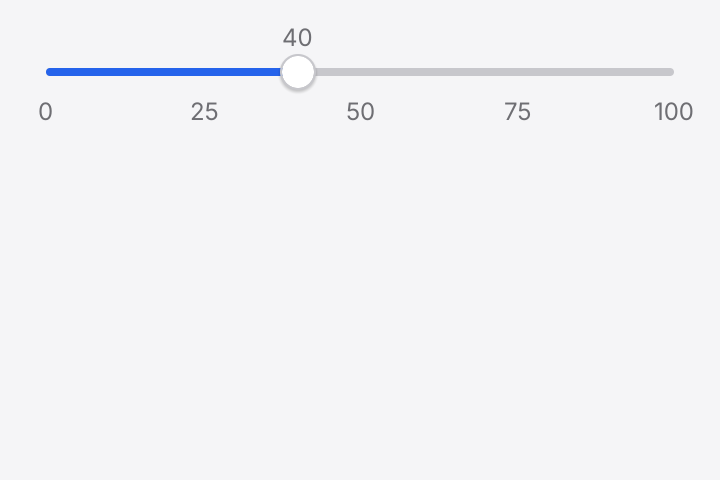
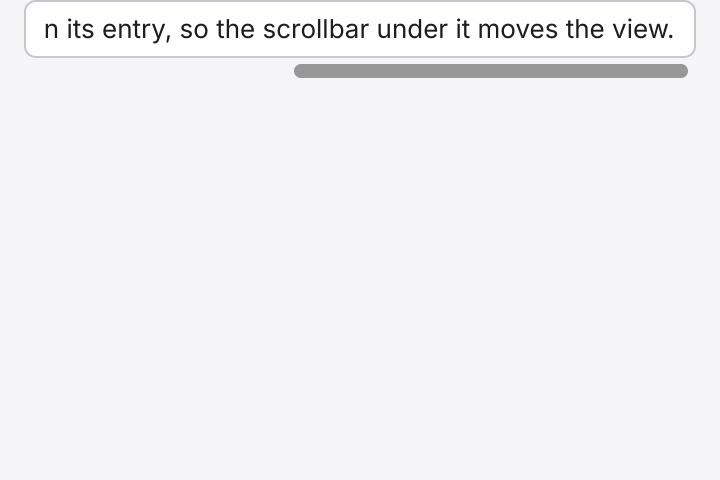

# Scale and scrollbar

**Live:** the Scale and Scrollbar cards of the [gallery](https://beetlebug.org/ztk/play/index.html?example=gallery).

## scale



<!-- widget: scale; shot: update -->
```tcl
set vol 40
scale .vol -orient horizontal -from 0 -to 100 -variable vol -tickinterval 25 -length 260
pack .vol -fill x -padx 12 -pady 8
```

### Play: Backspin

Backspin is a paddle match to 7 points, and the scale is your paddle. Drag the slider, or click the scale and press Up and Down: the paddle on the left goes to the value of the scale (`-variable pos`). A fast move of the scale at a hit puts spin on the ball. Click the court or press Space to serve. The rival gets faster in a long rally, and the ball gets faster with each hit. On the handheld, Up and Down call `.s set`, as the arrow keys of the scale do. With "Play on the page" on, a hit while the scale moves fast is a smash: the ball leaves the court, bounces off the headings and the code of this page, and comes back on the side of the rival. Escape or a scroll brings it back at once.

<!-- widget: toy-backspin; shot: update -->
```tcl
# Backspin: a paddle match to 7. The scale on the left is your paddle: drag it, or press Up and Down.
set ink {#1d1a33 #f2e6c4 #ef5b5b #ffcf5c #3a3560}
set W 300; set H 176; set P 28
scale .s -orient vertical -from 0 -to [expr {$H - $P}] -resolution 4 -variable pos -showvalue 0 -length $H -width 14
canvas .c -width $W -height $H -bg [lindex $ink 0] -highlightthickness 0
pack .s -side left -padx {6 4}
pack .c -side left
set pos 72
proc px {x y w h i} { .c create rectangle $x $y [expr {$x+$w}] [expr {$y+$h}] -fill [lindex $::ink $i] -width 0 }
for {set y 0} {$y < $H} {incr y 12} { px [expr {$W/2 - 2}] $y 4 8 4 }
foreach {tag i} {me 1 cpu 2 ball 3} { .c addtag $tag withtag [px 0 0 0 0 $i] }
.c create text [expr {$W/2}] 120 -tags msg -text "CLICK TO SERVE" -fill [lindex $ink 3] -font {TkFixedFont 13 bold}
.c create text [expr {$W/2}] 14 -tags score -fill [lindex $ink 1] -font {TkFixedFont 14 bold}
array set g {last 72 dy 0 cy 88 bx 150 by 80 vx 0 vy 0 me 0 cpu 0 run 0 out 0 hits 0}
array set toy {spill 0 out {} back {} sfx {}}
proc box {tag x y w h} { set x [expr {int($x)/4*4}]; set y [expr {int($y)/4*4}]; .c coords $tag $x $y [expr {$x+$w}] [expr {$y+$h}] }
# A click serves. After a match, it starts a new one.
proc serve {} {
    global g
    if {$g(run)} return
    if {$g(me) == 7 || $g(cpu) == 7} { array set g {me 0 cpu 0} }
    array set g [list bx [expr {$::W/2}] by 80 vx -3 vy [expr {rand()*2-1}] run 1 hits 0]
    .c itemconfigure msg -text ""
}
# The pad moves the scale as its arrow keys do.
proc toy_press {key} {
    switch $key { up { .s set [expr {[.s get] - 8}] } down { .s set [expr {[.s get] + 8}] } default serve }
}
bind .c <ButtonPress-1> serve
bind .s <space> serve
focus .s
proc tick {} {
    global g pos toy W H P
    # The speed of the scale is the speed of the paddle: it gives the ball spin.
    set g(dy) [expr {$g(dy) * 0.6 + ($pos - $g(last))}]
    set g(last) $pos
    # The rival speeds up as a rally goes on.
    set rival [expr {1.4 + 0.2 * $g(hits)}]
    set g(cy) [expr {$g(cy) + max(-$rival, min($rival, $g(by) - $g(cy)))}]
    if {$g(run) && !$g(out)} {
        set g(bx) [expr {$g(bx) + $g(vx)}]
        set g(by) [expr {$g(by) + $g(vy)}]
        if {$g(by) < 0 || $g(by) > $H - 8} { set g(vy) [expr {-$g(vy)}]; set g(by) [expr {max(0, min($H - 8, $g(by)))}]; lappend toy(sfx) wall }
        if {$g(vx) < 0 && $g(bx) < 16 && $g(bx) > 2 && $g(by) + 8 > $pos && $g(by) < $pos + $P} {
            incr g(hits)
            set g(vx) [expr {min(8, 0.3 - $g(vx))}]
            set g(vy) [expr {max(-6, min(6, $g(vy) + $g(dy) / 5.0))}]
            lappend toy(sfx) hit
            # A smash: a hit while the scale moves fast.
            if {abs($g(dy)) > 10 && $toy(spill)} {
                set toy(out) [list [expr {[winfo x .c] + $g(bx)}] [expr {[winfo y .c] + $g(by)}] [expr {$g(vx)*2}] [expr {$g(vy) - 6}]]
                set g(out) 1
            } elseif {abs($g(dy)) > 10} { set g(vx) 8 }
        }
        if {$g(vx) > 0 && $g(bx) > $W - 24 && $g(bx) < $W - 10 && abs($g(by) + 4 - $g(cy)) < 18} { set g(vx) [expr {-$g(vx)}]; lappend toy(sfx) hit }
        if {$g(bx) < -8 || $g(bx) > $W + 8} {
            incr g([expr {$g(bx) < 0 ? "cpu" : "me"}])
            set g(run) 0
            lappend toy(sfx) point
            .c itemconfigure msg -text [expr {$g(me) == 7 ? "YOU WIN THE MATCH" : $g(cpu) == 7 ? "THE RIVAL WINS" : "CLICK TO SERVE"}]
        }
    }
    # The page gives the ball back as {x vx vy hits}: it comes in at the rival side.
    if {$g(out) && $toy(back) ne ""} {
        lassign $toy(back) x g(vx) g(vy)
        set g(bx) [expr {$W/2}]; set g(by) 0; set g(out) 0; set toy(back) {}
    }
    box me 6 $pos 8 $P
    box cpu [expr {$W - 14}] [expr {$g(cy) - 16}] 8 32
    box ball [expr {$g(out) ? -20 : $g(bx)}] $g(by) 8 8
    .c itemconfigure score -text "$g(me)   $g(cpu)"
    after 16 tick
}
tick
```

- The slider follows the pointer on the render thread, so a drag stays smooth while the script is busy.
- The parts `::trough`, `::fill`, `::slider`, and `::value` accept CSS rules.

## scrollbar



<!-- widget: scrollbar; shot: update -->
```tcl
entry .e -width 22 -xscrollcommand {.s set}
scrollbar .s -orient horizontal -command {.e xview}
.e insert 0 "A long line of text that is wider than its entry, so the scrollbar under it moves the view."
pack .e .s -fill x -padx 12
```

- The modern scrollbar is an overlay. Its thumb shows while the view scrolls, on hover, and during a drag, and then fades out. The `classic` theme draws the scrollbar of Tk.
- A scroll by units or pages eases over 160 ms. A touchpad step adds momentum.
- The mouse wheel sends `<MouseWheel>` with `%D` (120 for one step), and `<Shift-MouseWheel>` for a horizontal step, as in Tk 8.7. A touchpad gives fractions of 120.
- The parts `::trough` and `::thumb` and the pseudo-class `:scrolling` accept CSS rules.
