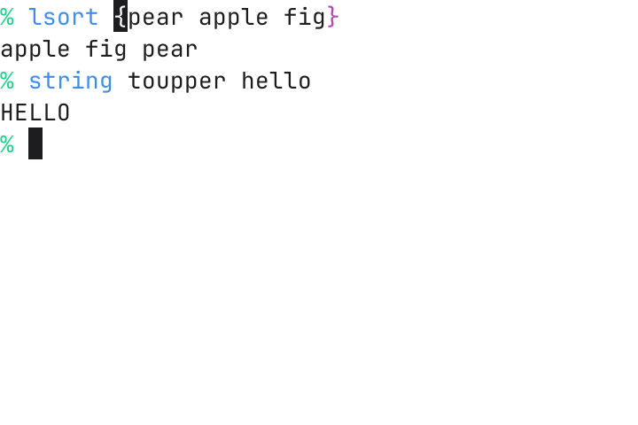

# Terminal

## ztk::terminal



<!-- widget: terminal; shot: update idletasks -->
```tcl
ztk::terminal .t -width 40 -height 12 -inputcommand echo
pack .t -fill both -expand 1
proc echo {data} {.t write [string map [list \r \r\n] $data]}
.t write "\x1b\[1;32m$\x1b\[0m echo hello\r\nhello\r\n"
.t write "\x1b\[1;34mblue\x1b\[0m \x1b\[7minverse\x1b\[0m \x1b\[4munderline\x1b\[0m\r\n"
.t write "╭────╮\r\n│ ok │\r\n╰────╯\r\n$ "
focus .t
```

`ztk::terminal` is a terminal emulator. ztk keeps the state of the terminal (the screen, the scrollback, the cursor, and the modes) and draws the cells with its own fonts and colors, so each renderer draws it. Tk has no terminal widget.

- `-command list` runs a program on a pseudo-terminal with `ztcl::pty spawn`, for example `-command {/bin/sh -l}` or `-command {vim notes.txt}`. The interpreter needs the `exec` capability of ztcl. The `ztk` program does not turn it on, so in `ztk` and in the playground `-command` gives an error. An embedder that turns on `exec` and `channels` gets a full terminal. `-cwd dir` is the working folder of the program, and `-exitcommand script` runs with the status of `ztcl::pty status` when the program ends. On Windows the program runs on a pseudo console (ConPTY), for example `-command cmd.exe` or `-command {powershell.exe -NoLogo}`, and its output has the escape sequences of a VT terminal.
- Without a program, `pathName write data` puts text and control sequences on the screen, and the keys and the replies of the terminal go to the script of `-inputcommand`, with the bytes as the last word.
- `-width` and `-height` are the size in cells. After the layout, the size of the grid follows the size of the widget, and the program gets the new size.
- The terminal understands the sequences of xterm that shells and full-screen programs use: the cursor moves, the erase and insert functions, the scroll region, SGR with 16, 256, and 24-bit colors, bold, italic, underline, inverse, and strike, the alternate screen, the DEC line drawing set, wide characters, bracketed paste, the mouse reports (X10, normal, button, and any-motion, in the SGR form or the X10 form), the focus reports, the window title, and the replies to the status queries and the color queries.
- The box drawing characters and the block elements are drawn as boxes, so their lines meet with each font.
- `-scrollback n` keeps n lines (default 10,000). The wheel and Shift with Prior or Next scroll the view, and `yview` works as for a listbox.
- A drag with button 1 selects text, a double click selects a word, and a triple click selects a line. Control-Shift-C copies the selection and Control-Shift-V pastes. When the program asks for mouse reports, hold Shift to select.
- Subcommands: `write`, `send`, `paste`, `get ?first? ?last?` (the text of view lines, where 0 is the first row of the screen and negative lines are in the scrollback), `size`, `cursor`, `title`, `selection get|clear|range`, `copy`, `yview`, `channel`, `status`, and `kill ?signal?`.
- The part `::selection` accepts CSS rules. The class `Terminal` gets its colors from the theme.

The terminal keeps no combining marks, and a resize cuts long lines and does not wrap them again. The plan of the terminal and the choice of a VT parser in Zig are in `docs/dev/terminal.md`.
