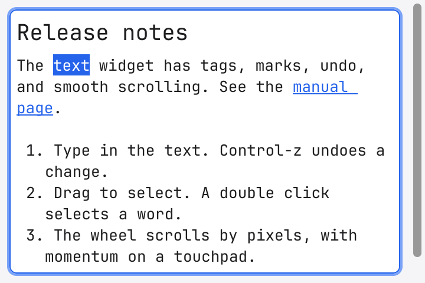

# Text

**Live:** the [playground](https://beetlebug.org/ztk/play/index.html) runs the example below.

## text



<!-- widget: text; shot: update -->
```tcl
text .t -wrap word -undo 1 -width 30 -height 8 -yscrollcommand {.sb set}
scrollbar .sb -command {.t yview}
.t tag configure title -font {TkDefaultFont 14 bold} -spacing3 6
.t tag configure link -foreground #2563eb -underline 1
.t tag configure step -lmargin1 8 -lmargin2 24
.t insert end "Release notes\n" title
.t insert end "The text widget has tags, marks, undo, and smooth scrolling. See the " {} "manual page" link ".\n\n"
.t insert end "1. Type in the text. Control-z undoes a change.\n" step
.t insert end "2. Drag to select. A double click selects a word.\n" step
.t insert end "3. The wheel scrolls by pixels, with momentum on a touchpad.\n" step
.t tag bind link <Enter> {.t configure -cursor hand2}
.t tag bind link <Leave> {.t configure -cursor xterm}
.t tag add sel 2.4 2.8
pack .sb -side right -fill y
pack .t -side left -fill both -expand 1 -padx 8 -pady 8
focus .t
```

<!-- more: The details of text -->

- The text widget has the options, the indexes, and the subcommands of Tk 8.6: `bbox`, `compare`, `count`, `delete`, `dlineinfo`, `dump`, `edit`, `get`, `image`, `index`, `insert`, `mark`, `replace`, `search`, `see`, `tag`, `window`, `xview`, and `yview`. `peer` has no peers in ztk. An index has the forms and the modifiers of `text.n`, such as `insert wordend`, `end - 1 chars`, and `insert + 1 display lines`. The unit `graphemes` (or a prefix such as `g`) is a ztk addition: `insert + 1 graphemes` counts grapheme clusters, so an accent, a flag, or an emoji with a skin tone is one step.
- Left, Right, Backspace, and Delete move and delete by grapheme cluster (Unicode UAX #29). A double click selects a word of UAX #29, such as `can't` or `3.14`. A wrapped line breaks only between clusters.
- Tags give text colors, fonts, underlines, margins, spacing, justification, and elided text. `tag bind` runs a script for the events of the tagged text, with `<Enter>` and `<Leave>` as the pointer moves between tags.
- `window create` puts a widget in the text, and `image create` puts a photo image in it. Each one has one place in the index space and moves with the text. `-align`, `-padx`, `-pady`, and `-stretch` place it in its line, and `-create` makes a window when the embed has none. `dump -window` and `dump -image` list them. A delete of the range of a window deletes the window.
- `search` finds exact text or a regular expression, forwards or backwards, with `-all`, `-count`, and `-nocase`. `dump` lists the text, the marks, and the tag edges of a range.
- Marks keep a place in the text with their gravity. `insert` is the caret and `current` is the character under the pointer.
- `-wrap char`, `word`, and `none` wrap the lines, and tabs go to the stops of `-tabs`. A buffer of 1 MB scrolls at the full frame rate: the widget lays out only the lines in the window.
- `-undo 1` turns on undo and redo, with `edit undo`, `edit redo`, `edit separator`, and Control-z. `<<Modified>>` comes when the text changes.
- The keys and the pointer edit the text as in `wish`. A scroll eases, and a touchpad scrolls by pixels with momentum. The caret blinks while the widget has the focus. Text from an input method shows at the caret until it is committed.
- The part `::selection` gives the colors of the tag `sel` in the modern theme.

<!-- end more -->


