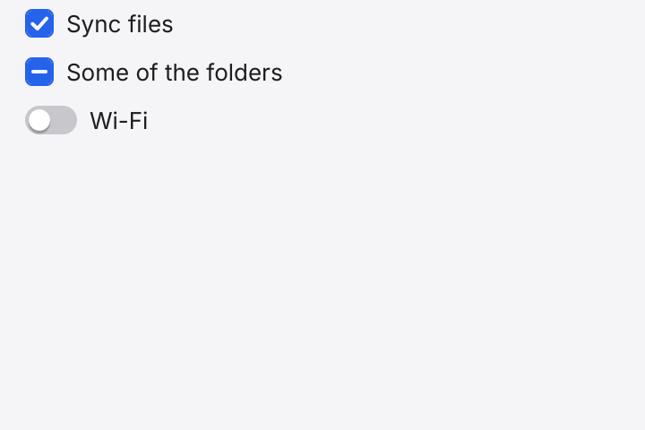

# Check and radio buttons

**Live:** the check button and radio button cards of the [gallery](https://beetlebug.org/ztk/play/index.html?example=gallery).

## checkbutton



<!-- widget: checkbutton; shot: update -->
```tcl
set opts(sync) 1
set opts(mixed) x
checkbutton .sync -text "Sync files" -variable opts(sync)
checkbutton .mixed -text "Some of the folders" -variable opts(mixed) -tristatevalue x
checkbutton .wifi -text "Wi-Fi" -variable opts(wifi)
ztk::class .wifi add switch
pack .sync .mixed .wifi -anchor w -padx 12 -pady 2
```

- The style class `switch` draws a check button as a switch. Its knob slides with a spring.
- A variable with the value of `-tristatevalue` shows the mixed state.
- `select`, `deselect`, `toggle`, and `invoke` work as in Tk. `flash` has no effect.

## radiobutton


<!-- widget: radiobutton; shot: update -->
```tcl
set quality high
foreach {v t} {low Draft normal Normal high "Fine detail"} {
    radiobutton .q$v -text $t -variable quality -value $v
    pack .q$v -anchor w -padx 12
}
frame .seg
foreach {v t} {list List grid Grid columns Columns} {
    radiobutton .seg.$v -text $t -variable view -value $v -indicatoron 0
    ztk::class .seg.$v add segmented
    pack .seg.$v -side left
}
set view list
pack .seg -padx 12 -pady 8
```

The style class `segmented` joins radio buttons with `-indicatoron 0` into a segmented control.

## In CSS

The indicator is the part `::indicator`, and the states are pseudo-classes:

```css
Checkbutton.switch:checked::indicator { background: #16a34a; }
Radiobutton:hover::indicator { border-color: var(--accent); }
```

The `ttk` forms are on [Themed widgets](ttk.md).
