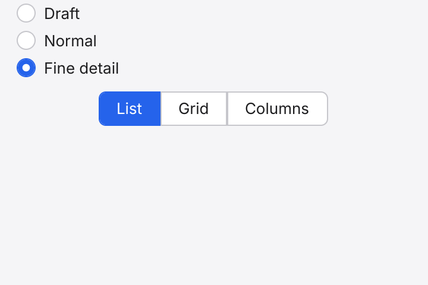

# Check and radio buttons

**Live:** the check button and radio button cards of the [gallery](https://beetlebug.org/ztk/play/index.html?example=gallery).

## checkbutton


<!-- widget: checkbutton; shot: update -->
```tcl
set opts(sync) 1
set opts(mixed) x
checkbutton .sync -text "Sync files" -variable opts(sync)
checkbutton .mixed -text "Some of the folders" -variable opts(mixed) -tristatevalue x
checkbutton .wifi -text "Wi-Fi" -variable opts(wifi)
ztk::class .wifi add switch
pack .sync .mixed .wifi -anchor w -padx 12 -pady 2
```

### Play: Moth Lamp

Moth Lamp is pinball on its side, and its check buttons are the table. "Top flipper" and "Low flipper" are the flippers: a flipper is up while its check button is on. Hold Up or Down, which call `select` on the press and `deselect` on the release, or click the check buttons. Each lamp that the ball hits lights its check button with `select`. The lamp buttons have `-state disabled`, so only the game sets them. Light all three lamps and the multiplier goes up, and the lamps go out. "Drain gate" closes the drain for 8 seconds of each ball, and a hit gives half the points while it is closed. Then the game deselects it and disables it until the next ball. You have three balls, and the ball gets faster the longer it stays in play. Click the table or press Space to launch. With "Play on the page" on, a hit with the middle of a flipper sends the ball out of the table, and each heading that it hits gives 500 points times the multiplier when it comes back.

<!-- widget: toy-mothlamp; shot: update -->
```tcl
# Moth Lamp: pinball on its side. Two check buttons are the flippers, and three show the lamps.
set ink {#1d1a33 #f2e6c4 #ef5b5b #ffcf5c #3a3560}
set H 150
canvas .c -width 330 -height $H -bg [lindex $ink 0] -highlightthickness 0
checkbutton .top -text "Top flipper" -variable flip(up)
checkbutton .low -text "Low flipper" -variable flip(down)
checkbutton .gate -text "Drain gate" -variable gate
foreach n {1 2 3} { checkbutton .lamp$n -text "Lamp $n" -variable lamp($n) -state disabled }
grid .c - - -padx 8 -pady {6 2}
grid .top .low .gate -sticky w -padx 10
grid .lamp1 .lamp2 .lamp3 -sticky w -padx 10
array set flip {up 0 down 0}; array set lamp {1 0 2 0 3 0}; set gate 0
# Three lamps: a hit gives 100 points and lights the check button of the lamp.
set bumpers {140 50 210 100 260 40}
foreach {x y} $bumpers { .c create oval [expr {$x-14}] [expr {$y-14}] [expr {$x+14}] [expr {$y+14}] -tags lamp -fill [lindex $ink 4] -width 0 }
.c create rectangle 0 0 4 $H -tags gatebar -fill [lindex $ink 4] -width 0
foreach {tag y} {up 34 down 116} { .c create rectangle 8 [expr {$y-20}] 16 [expr {$y+20}] -tags $tag -fill [lindex $ink 1] -width 0 }
.c create rectangle 0 0 8 8 -tags ball -fill [lindex $ink 2] -width 0
.c create text 250 136 -tags msg -text "CLICK TO LAUNCH" -fill [lindex $ink 3] -font {TkFixedFont 11 bold}
.c create text 324 10 -anchor e -tags score -fill [lindex $ink 1] -font {TkFixedFont 10 bold}
array set b {x 310 y 75 vx 0 vy 0 run 0 out 0 score 0 balls 3 mult 1 t 0 gt 0}
array set toy {spill 0 out {} back {} sfx {}}
# The keys hold a flipper up: a press selects its check button, and a release deselects it.
foreach {k w} {Up .top Down .low} { bind . <KeyPress-$k> "$w select"; bind . <KeyRelease-$k> "$w deselect" }
proc launch {} {
    global b
    if {$b(run)} return
    if {$b(balls) == 0} { array set b {score 0 balls 3 mult 1} }
    array set b [list x 310 y 75 vx -6 vy [expr {rand()*4-2}] run 1 t 0 gt 0]
    .gate configure -state normal
    .c itemconfigure msg -text ""
}
proc toy_press {key} {
    switch $key { up { .top select; after 140 {.top deselect} } down { .low select; after 140 {.low deselect} } default launch }
}
bind .c <ButtonPress-1> launch
bind . <space> launch
focus .c
proc tick {} {
    global b toy H gate bumpers flip lamp
    # The drain gate holds for 8 seconds of each ball, and then it opens for good.
    if {$gate && $b(run)} { incr b(gt); if {$b(gt) > 480} { .gate deselect; .gate configure -state disabled } }
    .c itemconfigure gatebar -fill [lindex $::ink [expr {$gate ? 1 : 4}]]
    foreach tag {up down} y {34 116} { .c coords $tag [expr {$flip($tag) ? 12 : 8}] [expr {$y-20}] [expr {$flip($tag) ? 22 : 16}] [expr {$y+20}] }
    set i 0
    foreach {x y} $bumpers { incr i; .c itemconfigure [lindex [.c find withtag lamp] [expr {$i-1}]] -fill [lindex $::ink [expr {$lamp($i) ? 3 : 4}]] }
    if {$b(run) && !$b(out)} {
        # The table leans to the left, and the ball speeds up as the ball stays in play.
        incr b(t)
        set k [expr {1 + min(0.8, $b(t) / 3000.0)}]
        set b(vx) [expr {$b(vx) - 0.1 * $k}]
        set b(x) [expr {$b(x) + $b(vx) * $k}]
        set b(y) [expr {$b(y) + $b(vy) * $k}]
        if {$b(y) < 0 || $b(y) > $H - 8} { set b(vy) [expr {-$b(vy)}]; set b(y) [expr {max(0, min($H - 8, $b(y)))}] }
        if {$b(x) > 322} { set b(vx) [expr {-abs($b(vx))}] }
        set i 0
        foreach {x y} $bumpers {
            incr i
            set dx [expr {$b(x) + 4 - $x}]; set dy [expr {$b(y) + 4 - $y}]
            set d [expr {hypot($dx, $dy)}]
            if {$d < 18} {
                set b(vx) [expr {5 * $dx / $d}]; set b(vy) [expr {5 * $dy / $d}]
                .lamp$i select
                incr b(score) [expr {($gate ? 50 : 100) * $b(mult)}]
                lappend toy(sfx) hit
                # All three lamps lit: the multiplier goes up, and the lamps go out.
                if {$lamp(1) && $lamp(2) && $lamp(3)} { incr b(mult); foreach n {1 2 3} { .lamp$n deselect }; lappend toy(sfx) point }
            }
        }
        if {$b(x) < 22 && $b(vx) < 0} {
            set f [expr {$b(y) < 75 ? "up" : "down"}]
            set fy [expr {$f eq "up" ? 34 : 116}]
            if {$flip($f) && abs($b(y) + 4 - $fy) < 24} {
                set b(vx) 8; set b(vy) [expr {($b(y) + 4 - $fy) / 4.0}]; set b(x) 22
                lappend toy(sfx) smash
                if {$toy(spill) && abs($b(y) + 4 - $fy) < 6} {
                    set toy(out) [list [expr {[winfo x .c] + $b(x)}] [expr {[winfo y .c] + $b(y)}] 8 -10 0.4]
                    set b(out) 1
                }
            } elseif {$gate && $b(x) < 6} { set b(vx) [expr {abs($b(vx))}]; lappend toy(sfx) wall
            } elseif {$b(x) < -8} {
                incr b(balls) -1; set b(run) 0; lappend toy(sfx) point
                .c itemconfigure msg -text [expr {$b(balls) ? "CLICK TO LAUNCH" : "GAME OVER: $b(score)"}]
            }
        }
    }
    # The page gives the ball back as {x vx vy hits}: each heading that it hit gives 500.
    if {$b(out) && $toy(back) ne ""} {
        lassign $toy(back) x b(vx) b(vy) hits
        set b(x) 200; set b(y) 0; set b(vx) [expr {-abs($b(vx))}]
        incr b(score) [expr {500 * $hits * $b(mult)}]
        set b(out) 0; set toy(back) {}
    }
    .c coords ball [expr {$b(out) ? -20 : int($b(x))/4*4}] [expr {int($b(y))/4*4}] [expr {$b(out) ? -12 : int($b(x))/4*4+8}] [expr {int($b(y))/4*4+8}]
    .c itemconfigure score -text "$b(score)  x$b(mult)  BALLS $b(balls)"
    after 16 tick
}
tick
```

- The style class `switch` draws a check button as a switch. Its knob slides with a spring.
- A variable with the value of `-tristatevalue` shows the mixed state.
- `select`, `deselect`, `toggle`, and `invoke` work as in Tk. `flash` has no effect.

## radiobutton



<!-- widget: radiobutton; shot: update -->
```tcl
set quality high
foreach {v t} {low Draft normal Normal high "Fine detail"} {
    radiobutton .q$v -text $t -variable quality -value $v
    pack .q$v -anchor w -padx 12
}
frame .seg
foreach {v t} {list List grid Grid columns Columns} {
    radiobutton .seg.$v -text $t -variable view -value $v -indicatoron 0
    ztk::class .seg.$v add segmented
    pack .seg.$v -side left
}
set view list
pack .seg -padx 12 -pady 8
```

The style class `segmented` joins radio buttons with `-indicatoron 0` into a segmented control.

## In CSS

The indicator is the part `::indicator`, and the states are pseudo-classes:

```css
Checkbutton.switch:checked::indicator { background: #16a34a; }
Radiobutton:hover::indicator { border-color: var(--accent); }
```

The `ttk` forms are on [Themed widgets](ttk.md).
