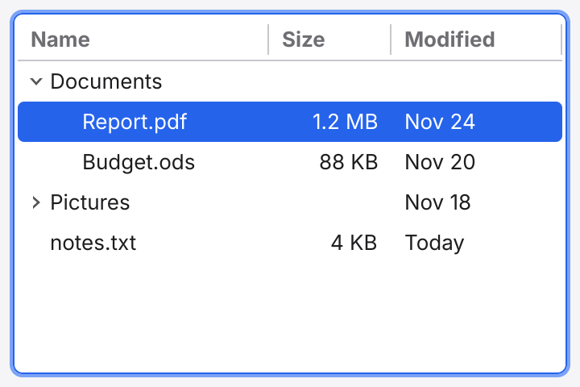

# Tree

**Live:** the [playground](https://beetlebug.org/ztk/play/index.html) runs the example below.

## ttk::treeview



<!-- widget: treeview; shot: update -->
```tcl
ttk::treeview .t -columns {size modified} -height 6
.t heading #0 -text Name -anchor w
.t heading size -text Size -anchor w
.t heading modified -text Modified -anchor w
.t column #0 -width 150
.t column size -width 70 -anchor e
.t column modified -width 100
.t insert {} end -id docs -text Documents -open 1
.t insert docs end -text Report.pdf -values {"1.2 MB" "Nov 24"}
.t insert docs end -text Budget.ods -values {"88 KB" "Nov 20"}
.t insert {} end -id pics -text Pictures -values {"" "Nov 18"}
.t insert pics end -text beach.png -values {"2.4 MB" "Nov 18"}
.t insert {} end -text notes.txt -values {"4 KB" Today}
.t selection set [lindex [.t children docs] 0]
pack .t -fill both -expand 1 -padx 8 -pady 8
focus .t
```

### Play: Disk Hound

Disk Hound is a race through an old disk: fetch 8 files in 90 seconds. A clue names each file, first by its name, then by its year, and last as the biggest or the smallest file of a folder. The arrow keys move and open the folders of the treeview, and Return or a double click fetches a file. A wrong file costs 8 seconds. B sniffs: it opens the next folder on the way, for 5 seconds.

<!-- widget: toy-diskhound; shot: update -->
```tcl
# Disk Hound: fetch 8 files from an old disk in 90 seconds. A clue names
# each file: first by its name, then by its year, and last as the biggest
# or the smallest file of a folder. Open the folders of the treeview, and
# press Return or double-click a file to fetch it.
set ink {#1d1a33 #f2e6c4 #ef5b5b #ffcf5c #3a3560 #6fc3df}
# The disk: a name with a dot is a file, and each other name is a folder
# with the list of its children after it.
set disk {
    games {arcade {moth.rom comet.rom} puzzle {ice.map gems.map} save.dat}
    tunes {chip {beep.mod buzz.mod} demo.mod}
    pics {pixel {cat.bmp moon.bmp} old {deep {map.gif}} sky.gif}
    notes {todo.txt lamp.txt secret {key.txt door.txt}}
    boot.sys
}
. configure -background [lindex $ink 0]
ttk::style configure Hound.Treeview -background [lindex $ink 4] \
    -fieldbackground [lindex $ink 4] -foreground [lindex $ink 1] -font {TkFixedFont 10}
ztk::style add "Treeview.Hound::selection { background-color: [lindex $ink 3]; color: [lindex $ink 0]; }"
canvas .c -width 340 -height 46 -bg [lindex $ink 0] -highlightthickness 0
ttk::treeview .t -style Hound.Treeview -columns {size year} -height 5 -selectmode browse
.t heading #0 -text File -anchor w
.t heading size -text Size -anchor e
.t heading year -text Year -anchor e
.t column #0 -width 190
.t column size -width 70 -anchor e
.t column year -width 70 -anchor e
.t tag configure dir -foreground [lindex $ink 3]
.t tag configure done -foreground [lindex $ink 5]
label .info -font {TkFixedFont 10 bold} -anchor w -background [lindex $ink 0] -foreground [lindex $ink 3]
pack .c -padx 8 -pady {6 0} -anchor w
pack .t -padx 8 -fill x
pack .info -padx 8 -fill x
array set toy {spill 0 out {} back {} sfx {}}
proc shuffle {items} {
    set keyed {}
    foreach x $items { lappend keyed [list [expr {rand()}] $x] }
    lmap p [lsort -index 0 $keyed] { lindex $p 1 }
}
# Each file gets a size and a year that no other file has, so each clue
# names one file.
proc fill {parent items depth} {
    global g
    for {set i 0} {$i < [llength $items]} {incr i} {
        set name [lindex $items $i]
        if {[string first . $name] < 0} {
            set id [.t insert $parent end -text $name/ -tags dir]
            fill $id [lindex $items [incr i]] [expr {$depth + 1}]
            continue
        }
        set kb [lindex $g(sizes) 0]
        set yr [lindex $g(years) 0]
        set g(sizes) [lrange $g(sizes) 1 end]
        set g(years) [lrange $g(years) 1 end]
        set id [.t insert $parent end -text $name -values [list "$kb KB" $yr] -tags file]
        lappend g(files) $id
        set g(kb,$id) $kb
        set g(depth,$id) $depth
    }
}
proc under {id} {
    set r {}
    foreach c [.t children $id] {
        if {[.t tag has file $c]} { lappend r $c } else { lappend r {*}[under $c] }
    }
    return $r
}
proc path {id} {
    set p [string trimright [.t item $id -text] /]
    while {[set id [.t parent $id]] ne ""} { set p [string trimright [.t item $id -text] /]/$p }
    return $p
}
# The clue of the next file. Later files are deeper in the disk.
proc clue {} {
    global g
    set n $g(found)
    set deep [expr {$n < 2 ? 0 : $n < 5 ? 1 : 2}]
    set left {}
    foreach f $g(files) {
        if {$f ni $g(done) && $g(depth,$f) >= $deep} { lappend left $f }
    }
    if {$n >= 5} {
        foreach d [shuffle [.t tag has dir]] {
            set fs [lsort -command {apply {{a b} { expr {$::g(kb,$a) - $::g(kb,$b)} }}} [under $d]]
            if {[llength $fs] < 2} continue
            set most [expr {rand() < 0.5 ? "biggest" : "smallest"}]
            set f [lindex $fs [expr {$most eq "biggest" ? "end" : 0}]]
            if {$f in $g(done)} continue
            set g(target) $f
            set g(clue) "$most in [path $d]/"
            return [paint]
        }
    }
    set g(target) [lindex [shuffle $left] 0]
    set g(clue) [expr {$n < 2 ? [.t item $g(target) -text] : "the file of [.t set $g(target) year]"}]
    paint
}
# The hound: pixel squares of 4 pixels. The tail is up after each fetch
# of an odd count.
proc hound {x y} {
    global ink g
    set rows [list [expr {$g(found) % 2 ? "#.....##" : "......##"}] \
        [expr {$g(found) % 2 ? ".....#R#" : "#....#R#"}] ".######." ".#####.." ".#...#.."]
    for {set r 0} {$r < 5} {incr r} {
        for {set c 0} {$c < 8} {incr c} {
            set ch [string index [lindex $rows $r] $c]
            if {$ch eq "."} continue
            set fill [lindex $ink [expr {$ch eq "R" ? 2 : 3}]]
            .c create rectangle [expr {$x + $c * 5}] [expr {$y + $r * 5}] \
                [expr {$x + $c * 5 + 5}] [expr {$y + $r * 5 + 5}] -fill $fill -outline {}
        }
    }
}
proc paint {} {
    global g ink
    .c delete all
    hound 2 8
    .c create text 52 12 -anchor w -text "FETCH: $g(clue)" -fill [lindex $ink 3] -font {TkFixedFont 11 bold}
    .c create text 52 34 -anchor w -fill [lindex $ink 1] -font {TkFixedFont 9 bold} \
        -text "FILE [expr {min($g(found) + 1, 8)}]/8  SCORE $g(score)  TIME [expr {max($g(ticks), 0) / 20}]"
}
proc note {text} { .info configure -text $text }
proc closeall {} {
    foreach d [.t tag has dir] { .t item $d -open 0 }
    set first [lindex [.t children {}] 0]
    .t focus $first
    .t selection set $first
    .t yview moveto 0
}
proc go {} {
    global g
    if {!$g(run) && !$g(over)} { set g(run) 1; tick }
}
proc fetch {{id ""}} {
    global g toy
    if {$g(over)} return
    if {$id eq ""} { set id [.t focus] }
    if {$id eq ""} return
    go
    if {[.t tag has dir $id]} { return [.t item $id -open [expr {![.t item $id -open]}]] }
    if {$id ne $g(target)} {
        incr g(ticks) -160
        lappend toy(sfx) wall
        return [note "Not that one: -8 seconds."]
    }
    lappend g(done) $id
    incr g(found)
    incr g(score) 100
    .t item $id -tags {file done}
    lappend toy(sfx) point
    if {$g(found) == 8} {
        incr g(score) [expr {$g(ticks) / 20 * 5}]
        return [over "All 8 fetched!"]
    }
    note "Good dog. [.t item $id -text] was in [path [.t parent $id]]/."
    closeall
    clue
}
# B sniffs: it opens the next closed folder on the way to the file, for
# 5 seconds.
proc sniff {} {
    global g
    if {$g(over)} return
    go
    incr g(ticks) -100
    set chain {}
    for {set p [.t parent $g(target)]} {$p ne ""} {set p [.t parent $p]} { set chain [linsert $chain 0 $p] }
    set to $g(target)
    foreach p $chain {
        if {![.t item $p -open]} { .t item $p -open 1; set to $p; break }
    }
    .t focus $to
    .t selection set $to
    .t see $to
    note "Sniff, sniff: -5 seconds."
}
proc rows {{p {}}} {
    set r {}
    foreach c [.t children $p] {
        lappend r $c
        if {[.t item $c -open]} { lappend r {*}[rows $c] }
    }
    return $r
}
proc step {d} {
    set r [rows]
    set i [expr {max(0, min([llength $r] - 1, [lsearch $r [.t focus]] + $d))}]
    set id [lindex $r $i]
    .t focus $id
    .t selection set $id
    .t see $id
}
proc over {text} {
    global g
    set g(run) 0
    set g(over) 1
    paint
    note "$text Score $g(score). Space: a new game."
}
proc tick {} {
    global g
    if {!$g(run)} return
    incr g(ticks) -1
    if {$g(ticks) <= 0} { return [over "Time is up: $g(found) of 8."] }
    if {$g(ticks) % 20 == 0} paint
    after 50 tick
}
proc newgame {} {
    global g
    array set g {found 0 score 0 ticks 1800 run 0 over 0 files {} done {}}
    set g(sizes) [shuffle {1 2 3 4 5 6 7 8 9 11 12 14 16 18 21 24 32 48 64}]
    set g(years) [shuffle {1979 1980 1981 1982 1983 1984 1985 1986 1987 1988 1989 1990 1991 1992 1993 1994 1995 1996}]
    .t delete [.t children {}]
    fill {} $::disk 0
    closeall
    clue
    note "Arrows move, Right opens, Return fetches."
}
bind .t <Key> go
bind .t <Return> { fetch; break }
bind .t <space> { if {$g(over)} newgame }
bind .t <Double-1> { if {[set id [.t identify item %x %y]] ne "" && [.t tag has file $id]} { fetch $id } }
bind .t <ButtonPress-1> go
proc toy_press {key} {
    if {$::g(over)} { newgame; return }
    switch $key { up { go; step -1 } down { go; step 1 } a fetch b sniff }
}
focus .t
newgame
```

<!-- more: The details of ttk::treeview -->

- The tree has the options, the item options, the column options, the heading options, the tag options, and the subcommands of `ttk_treeview.n`: `bbox`, `children`, `column`, `delete`, `detach`, `exists`, `focus`, `heading`, `identify`, `index`, `insert`, `item`, `move`, `next`, `parent`, `prev`, `see`, `selection`, `set`, `tag`, `xview`, and `yview`.
- A click selects a row, Shift extends the selection, and Control toggles a row with `-selectmode extended`. A click on the arrow or a double click opens and closes an item. The arrow keys move the focus, Right opens an item, and Left closes it. `<<TreeviewSelect>>`, `<<TreeviewOpen>>`, and `<<TreeviewClose>>` come as in `wish`.
- An item opens and closes with a move of the rows below it, and its arrow turns.
- A drag of the border at the right of a heading changes the width of the column. A click on a heading runs its `-command`.
- `tag configure` gives rows colors and fonts, and `tag bind` runs a script for the events of the rows with the tag.
- `-emptytext` shows a text when the tree has no items. The style class `sidebar` (`ztk::class .t sidebar`) gives a tree with no border, for the side of a window.

<!-- end more -->
