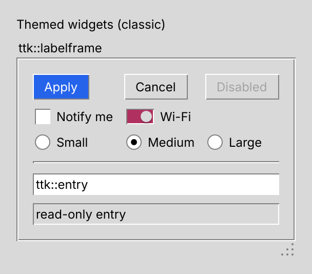

# Themed widgets (ttk)

ztk has the simple widgets of the Tk themed set: `ttk::button`, `ttk::checkbutton`, `ttk::radiobutton`, `ttk::label`, `ttk::frame`, `ttk::labelframe`, `ttk::entry`, `ttk::separator`, and `ttk::sizegrip`. Each one has the options of `wish` 8.6.16, in its order, with its defaults and its error messages. `ttk::style` restyles them, and the theme sets their look.

**Live:** the [ttk window in the modern theme](https://beetlebug.org/ztk/play/index.html?example=themes), the [same window in the classic theme](https://beetlebug.org/ztk/play/index.html?example=themes-classic), and the Themed widgets card of the [gallery](https://beetlebug.org/ztk/play/index.html?example=gallery).

| Modern theme | Classic theme |
|---|---|
|  |  |

[`examples/themes.tcl`](../../examples/themes.tcl) is the script of both images.

## The widgets

```tcl
ttk::style configure Accent.TButton -foreground white -background #2563eb
ttk::style map Accent.TButton -background {active #1d4ed8}

ttk::frame .f -padding 16
ttk::labelframe .f.lf -text "Options" -padding 10
ttk::button .f.lf.ok -text "Apply" -style Accent.TButton
ttk::checkbutton .f.lf.notify -text "Notify me" -variable notify
ttk::checkbutton .f.lf.wifi -text "Wi-Fi" -style Switch.TCheckbutton -variable wifi
ttk::radiobutton .f.lf.s -text "Small" -variable size -value S
ttk::radiobutton .f.lf.m -text "Medium" -variable size -value M
ttk::separator .f.lf.sep -orient horizontal
ttk::entry .f.lf.name -width 24
ttk::label .f.status -text "Ready"
ttk::sizegrip .f.grip
set notify 0
set wifi 1
set size M
grid .f.lf.ok .f.lf.notify .f.lf.wifi -sticky w -padx 4 -pady 4
grid .f.lf.s .f.lf.m -sticky w -padx 4 -pady 4
grid .f.lf.sep - - -sticky ew -pady 6
grid .f.lf.name - - -sticky ew -padx 4
pack .f -fill both -expand 1
pack .f.lf -fill both -expand 1
pack .f.status -side left -pady {8 0}
pack .f.grip -side right -anchor se
```

| Widget | Notes |
|---|---|
| `ttk::button` | `-style Accent.TButton` is a common style for the main action. `invoke` runs `-command`. |
| `ttk::checkbutton` | `-style Switch.TCheckbutton` draws a switch, in the modern theme and in the classic theme. A variable that does not exist shows the state `alternate`. |
| `ttk::radiobutton` | Buttons with the same `-variable` form a group. |
| `ttk::label` | `-image` with `-compound` puts an image beside the text. `-wraplength` breaks the text. |
| `ttk::frame`, `ttk::labelframe` | `-padding` sets the inner space. `-labelanchor` places the title. |
| `ttk::entry` | The commands of `entry`, with `-placeholder` and validation. See [Entry and spinbox](entry.md). |
| `ttk::separator` | `-orient horizontal` or `vertical`. Use `grid -sticky ew` to stretch it. |
| `ttk::sizegrip` | A drag resizes the toplevel with `wm geometry`. |

## How they differ from the classic widgets

A `ttk` widget gets its colors, fonts, and reliefs from its style. It has no `-background`, `-foreground`, `-font`, or `-relief`. A script that names one gets `unknown option`, as in `wish`. Change the look with `ttk::style` or CSS.

| Option | Widgets | Use |
|---|---|---|
| `-style` | all | The style name, for example `Accent.TButton`. |
| `-class` | all | The class for the option database and for CSS. |
| `-padding` | button, checkbutton, radiobutton, label, frame, labelframe | The inner space: one to four distances. |
| `-image`, `-compound` | button, label | An image and its place beside the text. |
| `-underline` | button, label, labelframe | Stored. It has no effect on the look yet. |

## state and instate

A `ttk` widget has a set of state flags: `active`, `disabled`, `focus`, `pressed`, `selected`, `background`, `readonly`, `alternate`, `invalid`, `hover`, and `user1` to `user6`.

```tcl
ttk::button .b -text "Save"
.b state disabled                     ;# returns !disabled, the flags to undo it
.b instate disabled                   ;# 1
.b instate !disabled {puts enabled}   ;# runs the script only in that state
.b state !disabled
```

`-state disabled` and `-state readonly` set the same flags. Each state is a CSS pseudo-class: `TButton:disabled`, `TCheckbutton:checked`, or `:state(user1)`. See [Styling and themes](../styling.md#ttkstyle).
