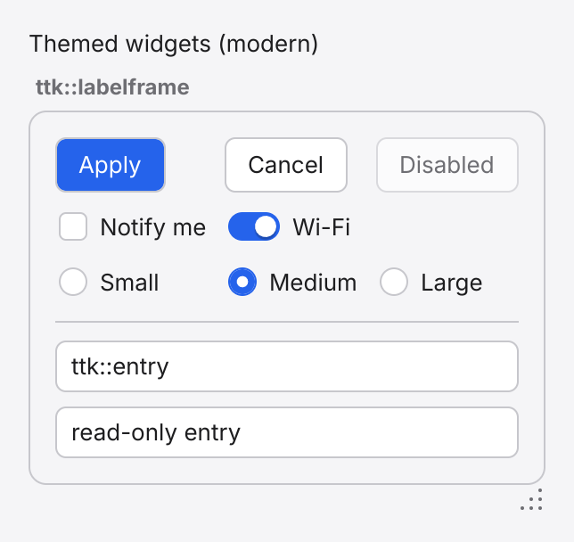
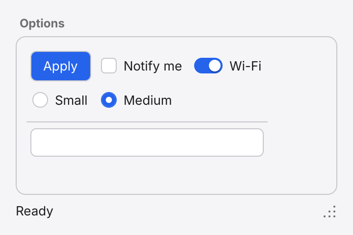
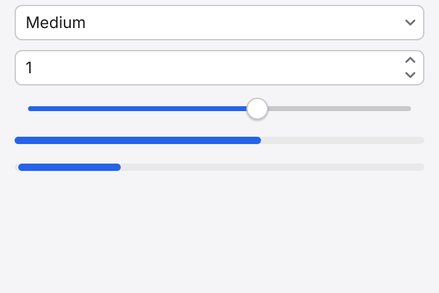

# Themed widgets (ttk)

ztk has these widgets of the Tk themed set: `ttk::button`, `ttk::checkbutton`, `ttk::radiobutton`, `ttk::label`, `ttk::frame`, `ttk::labelframe`, `ttk::entry`, `ttk::separator`, `ttk::sizegrip`, and the range widgets `ttk::combobox`, `ttk::spinbox`, `ttk::scale`, `ttk::scrollbar`, and `ttk::progressbar`. Each one has the options of `wish` 8.6.16, in its order, with its defaults and its error messages. `ttk::style` restyles them, and the theme sets their look.

**Live:** the [ttk window in the modern theme](https://beetlebug.org/ztk/play/index.html?example=themes), the [same window in the classic theme](https://beetlebug.org/ztk/play/index.html?example=themes-classic), and the Themed widgets card of the [gallery](https://beetlebug.org/ztk/play/index.html?example=gallery).

| Modern theme | Classic theme |
|---|---|
|  |  |

[`examples/themes.tcl`](../../examples/themes.tcl) is the script of both images.

## The widgets



<!-- widget: ttk; title: ttk buttons, entry, and labelframe; shot: update -->
```tcl
ttk::style configure Accent.TButton -foreground white -background #2563eb
ttk::style map Accent.TButton -background {active #1d4ed8}

ttk::frame .f -padding 16
ttk::labelframe .f.lf -text "Options" -padding 10
ttk::button .f.lf.ok -text "Apply" -style Accent.TButton
ttk::checkbutton .f.lf.notify -text "Notify me" -variable notify
ttk::checkbutton .f.lf.wifi -text "Wi-Fi" -style Switch.TCheckbutton -variable wifi
ttk::radiobutton .f.lf.s -text "Small" -variable size -value S
ttk::radiobutton .f.lf.m -text "Medium" -variable size -value M
ttk::separator .f.lf.sep -orient horizontal
ttk::entry .f.lf.name -width 24
ttk::label .f.status -text "Ready"
ttk::sizegrip .f.grip
set notify 0
set wifi 1
set size M
grid .f.lf.ok .f.lf.notify .f.lf.wifi -sticky w -padx 4 -pady 4
grid .f.lf.s .f.lf.m -sticky w -padx 4 -pady 4
grid .f.lf.sep - - -sticky ew -pady 6
grid .f.lf.name - - -sticky ew -padx 4
pack .f -fill both -expand 1
pack .f.lf -fill both -expand 1
pack .f.status -side left -pady {8 0}
pack .f.grip -side right -anchor se
```

| Widget | Notes |
|---|---|
| `ttk::button` | `-style Accent.TButton` is a common style for the main action. `invoke` runs `-command`. |
| `ttk::checkbutton` | `-style Switch.TCheckbutton` draws a switch, in the modern theme and in the classic theme. A variable that does not exist shows the state `alternate`. |
| `ttk::radiobutton` | Buttons with the same `-variable` form a group. |
| `ttk::label` | `-image` with `-compound` puts an image beside the text. `-wraplength` breaks the text. |
| `ttk::frame`, `ttk::labelframe` | `-padding` sets the inner space. `-labelanchor` places the title. |
| `ttk::entry` | The commands of `entry`, with `-placeholder` and validation. See [Entry and spinbox](entry.md). |
| `ttk::separator` | `-orient horizontal` or `vertical`. Use `grid -sticky ew` to stretch it. |
| `ttk::sizegrip` | A drag resizes the toplevel with `wm geometry`. |

## The range widgets



<!-- widget: ttk-range; title: ttk combobox, scale, and progressbar; shot: update idletasks -->
```tcl
set level 60
ttk::combobox .size -values {Small Medium Large} -state readonly
.size current 1
bind .size <<ComboboxSelected>> {puts "size: [.size get]"}
ttk::spinbox .copies -from 1 -to 10 -width 4
.copies set 1
ttk::scale .volume -from 0 -to 100 -variable level
ttk::progressbar .meter -maximum 100 -variable level
ttk::progressbar .busy -mode indeterminate
after 500 {.busy start}
pack .size .copies .volume .meter .busy -fill x -padx 12 -pady 4
```

### Play: Tin Moon

Tin Moon is a lander game, and two ttk widgets are its controls. The `ttk::scale` on the right is the throttle: drag it, or click it and press the arrow keys, and ride it to fight gravity. The `ttk::progressbar` under the screen is the fuel gauge (`-variable fuel`), and the engine empties it at the rate of the throttle. Put the ship down on the gold pad slowly and level: the fuel that is left adds to the score. Each level has less fuel, a narrower pad, and more gravity, and a crash costs one of three ships. Press Space or click the screen to start. Z and X, or B and A on the handheld, fire the side jets, and Up and Down on the handheld move the throttle. With "Play on the page" on, a ship that flies out of the top of the screen falls across the page, and each heading or code block that it hits gives 10 fuel back.

<!-- widget: toy-tinmoon; shot: update -->
```tcl
# Tin Moon: a lander. The scale is the throttle, and the progress bar is the fuel gauge.
set ink {#1d1a33 #f2e6c4 #ef5b5b #ffcf5c #3a3560}
set W 296; set H 176
expr {srand(7)}
canvas .c -width $W -height $H -bg [lindex $ink 0] -highlightthickness 0
ttk::scale .thr -orient vertical -from 100 -to 0 -variable throttle -length $H
ttk::label .tank -text Fuel
ttk::progressbar .fuel -maximum 100 -variable fuel
grid .c .thr -padx 4 -pady {4 0}
grid .tank -row 1 -column 0 -sticky w -padx 8
grid .fuel -row 1 -column 0 -sticky ew -padx {48 8} -pady 6
for {set i 0} {$i < 24} {incr i} {
    set x [expr {int(rand()*78)*4}]; set y [expr {int(rand()*20)*4}]
    .c create rectangle $x $y [expr {$x+2}] [expr {$y+2}] -fill [lindex $ink 4] -width 0
}
proc sprite {tags rows color dx dy} {
    foreach row $rows {
        set x $dx
        foreach ch [split $row ""] {
            if {$ch eq "#"} { .c create rectangle $x $dy [expr {$x+2}] [expr {$dy+2}] -tags $tags -fill $color -width 0 }
            incr x 2
        }
        incr dy 2
    }
}
sprite ship {..###.. .#####. ##.#.## .#####. .#...#. ##...##} [lindex $ink 1] 0 0
# The flame has three rows: the throttle shows one, two, or three.
for {set r 0} {$r < 3} {incr r} { sprite "ship flame f$r" [list [lindex {.#.#. ..#.. ..#..} $r]] [lindex $ink [expr {$r ? 3 : 2}]] 2 [expr {12 + 2*$r}] }
.c create text [expr {$W/2}] 70 -tags msg -fill [lindex $ink 3] -font {TkFixedFont 12 bold}
.c create text [expr {$W - 6}] 10 -anchor e -tags score -fill [lindex $ink 1] -font {TkFixedFont 9 bold}
array set toy {spill 0 out {} back {} sfx {}}
array set b {x 0 y 0 px 0 py 0 run 0 out 0}
set throttle 0; set level 1; set ships 3; set score 0; set fuel 100
# A level: a rough ground with a gold pad. A higher level has less fuel, a narrow pad, and more gravity.
proc level {} {
    global ground pad H W ink b fuel level padw
    .c delete land
    set padw [expr {max(2, 5 - $level / 2)}]
    set n [expr {$W / 8}]
    set pad [expr {4 + int(rand() * ($n - 8 - $padw))}]
    set y 140; set ground {}
    for {set i 0} {$i < $n} {incr i} {
        if {$i < $pad || $i >= $pad + $padw} { set y [expr {max(96, min(168, $y + int(rand()*25) - 12))}] }
        lappend ground $y
        set c [expr {$i >= $pad && $i < $pad + $padw ? 3 : 4}]
        .c create rectangle [expr {$i*8}] $y [expr {$i*8+8}] $H -tags land -fill [lindex $ink $c] -width 0
    }
    array set b [list x 20 y 10 vx [expr {0.4 + 0.1 * $level}] vy 0 run 0]
    set fuel [expr {max(40, 100 - 8 * ($level - 1))}]
    set ::throttle 0
    .c itemconfigure msg -text "LEVEL $level: PRESS SPACE"
}
level
proc start {} {
    global b ships level score
    if {$b(run)} return
    if {$ships == 0} { set ships 3; set level 1; set score 0; level }
    set b(run) 1; .c itemconfigure msg -text ""
}
proc jet {d} { global b fuel; if {$b(run) && $fuel > 1} { set b(vx) [expr {$b(vx) + $d}]; set fuel [expr {$fuel - 1}]; lappend ::toy(sfx) hit } }
proc toy_press {key} {
    switch $key {
        up { .thr set [expr {min(100, [.thr get] + 10)}] }
        down { .thr set [expr {max(0, [.thr get] - 10)}] }
        a { if {$::b(run)} { jet 0.12 } else start }
        b { if {$::b(run)} { jet -0.12 } else start }
    }
}
bind . <space> start
bind . <Key-z> {jet -0.12}
bind . <Key-x> {jet 0.12}
bind .c <ButtonPress-1> start
focus .thr
proc tick {} {
    global b toy fuel ground pad padw score ships level throttle W H
    set burn [expr {$b(run) && $fuel > 0 ? $throttle / 100.0 : 0}]
    if {$b(run) && !$b(out)} {
        set b(vy) [expr {$b(vy) + 0.025 + 0.004 * $level - 0.07 * $burn}]
        set fuel [expr {max(0, $fuel - 0.3 * $burn)}]
        set b(x) [expr {max(0, min($W - 14, $b(x) + $b(vx)))}]
        set b(y) [expr {$b(y) + $b(vy)}]
        if {$b(y) < -12} {
            # Out of the top: with play on the page, the ship falls across the page.
            if {$toy(spill)} { set toy(out) [list [expr {[winfo x .c] + $b(x)}] [winfo y .c] $b(vx) $b(vy) 0.25]; set b(out) 1; lappend toy(sfx) smash } else { set b(y) -12; set b(vy) 0 }
        }
        set c0 [expr {int($b(x)) / 8}]; set c1 [expr {int($b(x) + 13) / 8}]
        set top [tcl::mathfunc::min {*}[lrange $ground $c0 $c1]]
        if {$b(y) + 12 >= $top} {
            set b(y) [expr {$top - 12}]; set b(run) 0; set throttle 0
            if {$c0 >= $pad && $c1 < $pad + $padw && $b(vy) < 1.0 && abs($b(vx)) < 0.7} {
                incr score [expr {100 * $level + int($fuel)}]
                incr level
                lappend toy(sfx) point
                after 1200 level
                .c itemconfigure msg -text "LANDED"
            } else {
                incr ships -1
                lappend toy(sfx) wall
                if {$ships == 0} { .c itemconfigure msg -text "GAME OVER: PRESS SPACE" } else { after 1200 level; .c itemconfigure msg -text "CRASH" }
            }
        }
    }
    # The page gives the ship back as {x vx vy hits}: each wall that it hit gives 10 fuel.
    if {$b(out) && $toy(back) ne ""} {
        lassign $toy(back) x
        set fuel [expr {min(100, $fuel + 10 * [lindex $toy(back) 3])}]
        set b(y) -10; set b(vy) 0.5; set b(out) 0; set toy(back) {}
    }
    set nx [expr {$b(out) ? -40 : int($b(x)) / 2 * 2}]; set ny [expr {int($b(y)) / 2 * 2}]
    .c move ship [expr {$nx - $b(px)}] [expr {$ny - $b(py)}]
    set b(px) $nx; set b(py) $ny
    for {set r 0} {$r < 3} {incr r} { .c itemconfigure f$r -state [expr {$burn > $r / 3.0 ? "normal" : "hidden"}] }
    .c itemconfigure score -text "SCORE $score  LEVEL $level  SHIPS $ships"
    after 16 tick
}
tick
```

| Widget | Notes |
|---|---|
| `ttk::combobox` | An entry with a list of `-values`. A press on the arrow, or the Down key, opens the list. A readonly combobox opens it on a press anywhere. `-postcommand` runs before the list opens. A choice from the list sends `<<ComboboxSelected>>`. `current` gives or sets the index of the text in `-values`, and `set` sets the text. `-placeholder` shows a hint in an empty field. |
| `ttk::spinbox` | An entry with up and down buttons. It steps through `-values`, or from `-from` to `-to` by `-increment`, with `-format` and `-wrap`. The Up and Down keys send `<<Increment>>` and `<<Decrement>>`. |
| `ttk::scale` | A slider from `-from` to `-to` (0 to 1.0 by default) with no resolution. `get` gives `-value`, and `set` runs `-command` with the new value. A `-variable` that does not exist stays unset until the value changes. |
| `ttk::scrollbar` | The overlay scrollbar of the modern theme, with `set first last`, `get`, `delta`, and `fraction`. `identify` gives `thumb` or `trough`. |
| `ttk::progressbar` | `-mode determinate` fills `-value / -maximum` of the track. `-mode indeterminate` moves a short bar. `step ?amount?` adds to the value and wraps at `-maximum`. `start ?interval?` steps it with a timer, and `stop` ends the timer. A `-variable` with text that is not a number sets the state `invalid`. |

The list of a combobox is a popover with a round corner and a shadow. It opens below the field, or above it when the window has no room below. The arrow keys move the highlight, Return chooses, and Escape or a press outside closes the list. The list fades in and slides 6 pixels in 150 ms, and it closes the same way. The determinate bar eases to a new value in 200 ms. While `start` runs, the indeterminate bar moves back and forth on the render thread, so a busy script does not stop it.

The parts for CSS: `TCombobox::arrow`, `::popdown`, `::item`, and `::item-active`; `TProgressbar::trough` and `::bar`. A `ttk::scale`, a `ttk::spinbox`, and a `ttk::scrollbar` match the rules of `Scale`, `Spinbox`, and `Scrollbar` too, and a `ttk::combobox` the rules of `Entry`.

## How they differ from the classic widgets

A `ttk` widget gets its colors, fonts, and reliefs from its style. It has no `-background`, `-foreground`, `-font`, or `-relief`. A script that names one gets `unknown option`, as in `wish`. Change the look with `ttk::style` or CSS.

| Option | Widgets | Use |
|---|---|---|
| `-style` | all | The style name, for example `Accent.TButton`. |
| `-class` | all | The class for the option database and for CSS. |
| `-padding` | button, checkbutton, radiobutton, label, frame, labelframe | The inner space: one to four distances. |
| `-image`, `-compound` | button, label | An image and its place beside the text. |
| `-underline` | button, label, labelframe | Stored. It has no effect on the look yet. |

## state and instate

A `ttk` widget has a set of state flags: `active`, `disabled`, `focus`, `pressed`, `selected`, `background`, `readonly`, `alternate`, `invalid`, `hover`, and `user1` to `user6`.

```tcl
ttk::button .b -text "Save"
.b state disabled                     ;# returns !disabled, the flags to undo it
.b instate disabled                   ;# 1
.b instate !disabled {puts enabled}   ;# runs the script only in that state
.b state !disabled
```

`-state disabled` and `-state readonly` set the same flags. Each state is a CSS pseudo-class: `TButton:disabled`, `TCheckbutton:checked`, or `:state(user1)`. See [Styling and themes](../styling.md#ttkstyle).
